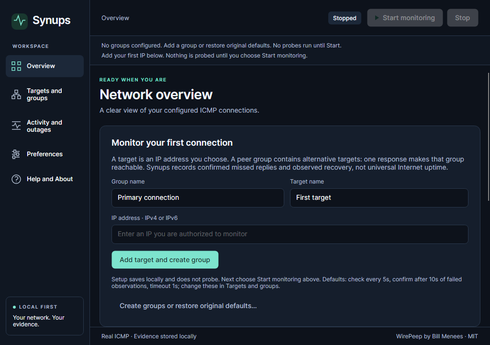
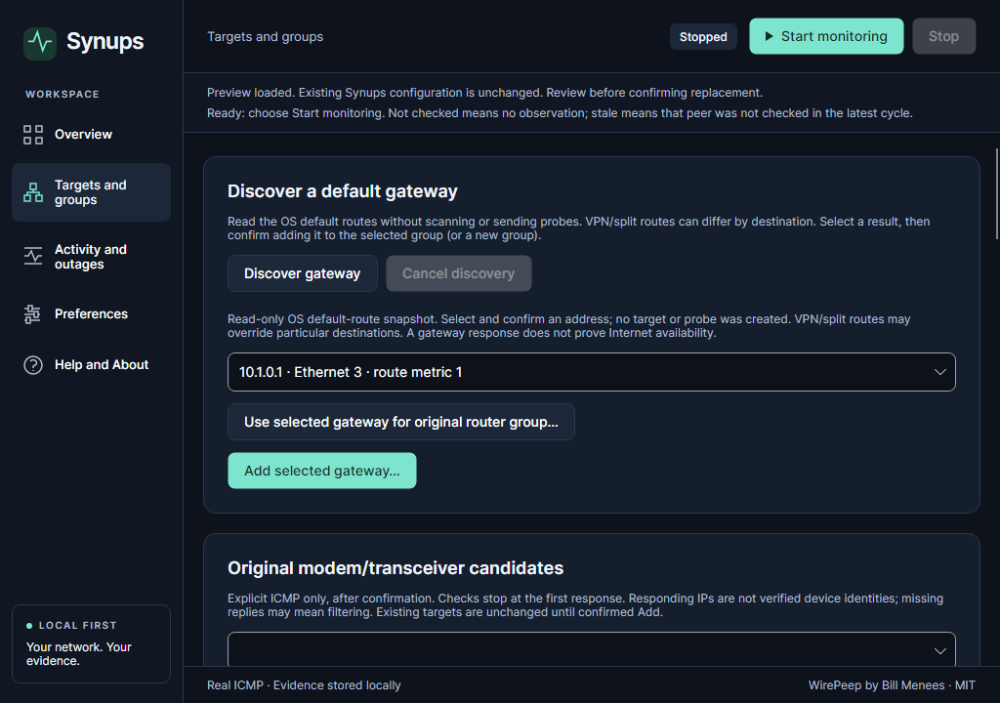
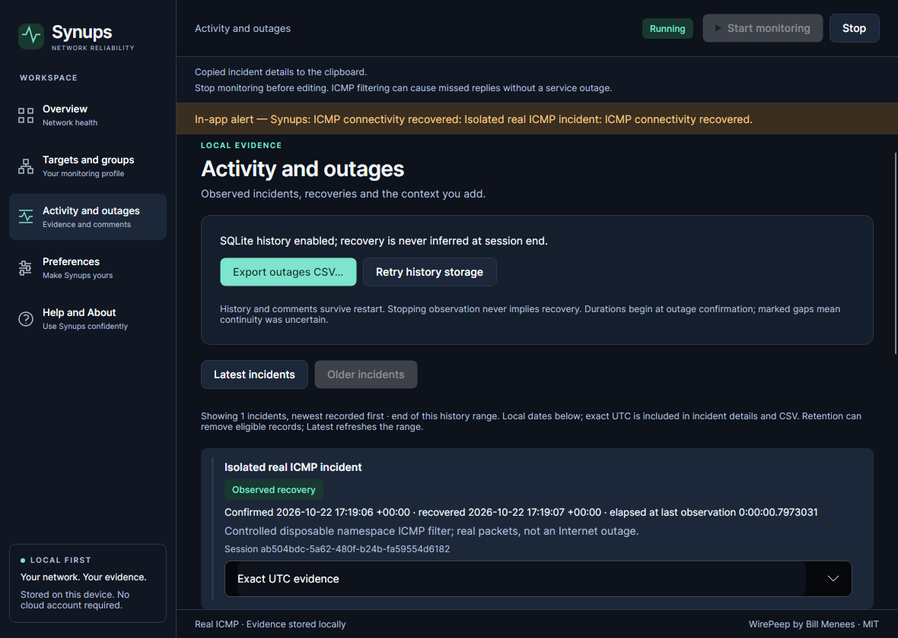

# Synups

Synups is a local-first Avalonia desktop monitor that turns real ICMP reachability checks into durable outage timelines, comments and exportable evidence on Windows, macOS and Linux.

| Before: Bill Menees’ WirePeep · Windows WPF | After: Synups · Windows Avalonia |
|---|---|
|  |  |

Before: untouched upstream `61ae143`, actual Windows/.NET Framework 4.8 window; outbound traffic blocked **only for that executable**. After: public v0.1.1 / internal rc.4, source `6c812fd`, Windows Server 2025 x64, actual extracted apphost client-tree render with real loopback. These are different observations, not a benchmark or ISP outage. [Exact revisions, execution context and image hashes](docs/competition/SCREENSHOTS.md).

## The migration: four questions

**How much work did the migration take?** Work began **October 16, 2026**; the application froze **October 22**. The verified upstream-to-release Git range contains **39 commits**. Using the same C#/XAML physical-line method, original production source has **4,374 lines** and Synups **4,469**, with **2,756 test lines** counted separately. The new scope includes durable storage, async execution and OS adapters; line counts are not effort estimates. Work was AI-assisted; no developer-hours total was measured. The release has **164 unique .NET cases** across platform/invocation combinations and **91.7% weighted legacy parity**. [Reproducible measurements, exclusions and exact range](docs/migration/MIGRATION_MEASUREMENTS.md).

**What translated cleanly?** Target GUIDs and literal-IP identity, peer grouping, sorted rotating probes, stop on first success, failure grace and incident/comment intent survived the port. Original settings compatibility preserves supported profile IDs and timings using a genuine Menees `.stgx` fixture, preview and confirmed replacement with backup. Five linked-original characterization tests protect the inherited state/rotation behavior. [Original semantics and source](docs/migration/LEGACY_SEMANTICS.md) · [source-to-source audit, including settings](docs/migration/FEATURE_PARITY.md).

**What needed rethinking?** WPF composition and window-owned scheduling could not carry over to other desktops. Avalonia presentation now sits over UI-free monitoring with bounded async probes, owned cancellation and awaited shutdown. Monotonic time measures durations; UTC records observations. Explicit error/unknown states prevent a failed probe or shutdown from inventing recovery. SQLite replaces session-only incidents with durable comments, restart handling and failed-write recovery. Native tray, login and alert adapters isolate OS-specific behavior. [Original problems, implementations and tests](docs/migration/FEATURE_PARITY.md#why-this-migration-was-technically-difficult) · [architecture decisions](docs/migration/ARCHITECTURE.md#architecture-decisions-and-operational-trade-offs).

**What surprised you?** A Linux window without a real window manager did not prove minimize/restore behavior; Openbox made that check meaningful. Notification requests did not prove delivery, and the failed Windows adapter was withdrawn. macOS archive handling affected signature integrity. Async UI actions exposed focus/lifecycle races, while SQLite failures required retaining pending evidence through shutdown. These failures changed the implementation and the acceptance claims. [Dated migration log](docs/migration/MIGRATION_LOG.md) · [distribution findings](docs/release/DISTRIBUTION_TRUST.md).

## Migration at a Glance

| Review point | Public v0.1.1 |
|---|---|
| Origin / attribution | [Bill Menees’ WirePeep](https://github.com/menees/WirePeep), MIT; original source and resources preserved |
| Port | WPF → Avalonia, C# and XAML; Core monitoring separated from desktop composition |
| Parity rubric | **(15 complete + 3 partial × 0.5) / 18 = 91.7%**; alerts, preferences and placement/tray remain partial |
| Evaluation | [2026 Avalonia Port Challenge](https://avaloniaui.net/blog/avalonia-port-challenge), intended Best IT Pro Tool category; [five-minute judge’s guide](docs/competition/JUDGES_GUIDE.md) |

## Download and run

**Public [v0.1.1](https://github.com/samscript18/Synups/releases/tag/v0.1.1)** needs no account, backend or .NET SDK. Extract the **complete archive** and keep its files together.

| Platform | Direct download | Installation |
|---|---|---|
| Windows x64 | [ZIP](https://github.com/samscript18/Synups/releases/download/v0.1.1/Synups-win-x64.zip) | Extract; launch `Synups.exe`. Unsigned: Windows or organizational policy may warn or block. |
| macOS arm64 | [tar.gz](https://github.com/samscript18/Synups/releases/download/v0.1.1/Synups-osx-arm64.tar.gz) | Extract; launch `Synups.app` where system policy permits. No Developer ID signing or notarization; retained Gatekeeper assessment rejects trusted distribution. |
| Linux x64 | [tar.gz](https://github.com/samscript18/Synups/releases/download/v0.1.1/Synups-linux-x64.tar.gz) | Extract preserving executable permission; launch `./Synups` in a graphical desktop with required native libraries. Tested on Ubuntu 24.04, X11/Xvfb + Openbox. |

[Installation and native dependencies](docs/release/INSTALLATION.md) · [SHA256SUMS](https://github.com/samscript18/Synups/releases/download/v0.1.1/SHA256SUMS). Do not bypass OS security protections. Checksums establish byte integrity, not publisher identity.

Released binaries retain internal **0.1.1-rc.4**, frozen application **`6c812fde9a29eeb8cfd6399a2f1a75e333e81e03`**. About/manifests and historical archive handoff text remain unchanged; this README and the public release description describe current publication status. [All 15 published assets and hashes](docs/evidence/verification/synups-0.1.1-publication.json).

This is desktop-first because monitoring needs local ICMP, native lifecycle/tray integration and persistent local evidence. A browser sandbox or mobile background lifecycle would require a different execution model; neither is a supported product here.

## Key product capabilities

- **Monitor selected peers:** configurable groups, rotating alternatives, finite-timeout ICMP and failure grace. A group stops probing after its first success; other peers can remain stale/not checked.
- **Retain evidence:** confirmed incidents, observed recovery, comments, interrupted sessions and SQLite history; paginated review, database backup, chronological UTC CSV and automatic session logs.
- **See uncertainty:** connected, disconnected, unavailable, stale and not-checked states. Only successful probes produce RTT; ICMP loss alone does not establish Internet failure.
- **Configure deliberately:** first-target setup, original-profile import, preferences and explicit gateway/candidate discovery. Confirm before adding; no automatic subnet scan or network reconfiguration.

| First-target setup · rc.4 | Original-settings import action · rc.4 | Incident timeline · historical rc.3 |
|---|---|---|
|  |  |  |

Setup/import: source `6c812fd`, Windows Server 2025 x64, programmatically driven extracted apphost client renders. **The retained import image shows “Preview loaded”, not the complete review UI**; a full-preview screenshot is unavailable. Import/confirmation/backup are verified in native action reports. Incident: source `7ca85cc`, Linux Xvfb/Openbox production-source component harness in a disposable network namespace, **not a fresh rc.4 packaged-executable demo**. [Per-image provenance](docs/competition/SCREENSHOTS.md) · [original rc.3 incident sequence and CSV](docs/competition/INCIDENT_DEMO.md).

To begin: launch, enter a group/name and authorized literal IP, choose **Add target and create group**, then **Start monitoring**. Opening the app sends no probes unless monitoring-on-launch was deliberately enabled. Review **Activity and outages** when records exist; stop before editing configuration. [Evaluation walkthrough](docs/competition/JUDGES_GUIDE.md#five-minute-evaluation).

## Cross-platform verification

These are **v0.1.1-specific** results from [exact-source native CI](https://github.com/samscript18/Synups/actions/runs/39850198899), not diagnostics alpha results.

| Executed environment | Compiled .NET default tests | Separate real/native evidence | Extracted executable | Major remaining limitation |
|---|---|---|---|---|
| Windows Server 2025 x64 | 159 passed, 5 intentional skips | 3 passed; 1 audio-request check | Six stages passed | Unsigned; native notification delivery failed observation |
| macOS 15 arm64 | 159 passed, 5 intentional skips | 3 passed; 1 audio-request check | Six stages passed; repeated locally | No Developer ID/notarization; physical acceptance incomplete |
| Ubuntu 24.04 x64, Xvfb + Openbox | 160 passed, 4 intentional skips | 3 passed; 1 safe audio-fallback check | Six stages passed | Virtual X11 desktop; wider Wayland/physical acceptance unverified |

Each OS also passed eight Python safety tests and zero-warning Release builds. The **164 unique .NET cases** span invocations/platforms; they are not 164 default passes per OS. Extracted apphosts exercised real loopback, native windows/restoration, clipboard, genuine import/backup, preferences and SQLite restart/interruption/read-only repair. Five normal stages exited zero; the deliberate-kill stage expected nonzero termination. These are executed binaries with programmatically driven controls, not physical tray/keyboard/Save-panel or audible-delivery certification. [Retained reports and package hashes](docs/evidence/verification/2026-10-22-desktop-completion.json) · [full platform matrix](docs/migration/CROSS_PLATFORM.md).

## Known limitations and distribution trust

- **Distribution:** unsigned Windows; macOS ad-hoc integrity without Developer ID/notarization. Linux evidence covers the stated X11 environment. [Trust findings](docs/release/DISTRIBUTION_TRUST.md).
- **Desktop integration:** notification delivery/audibility, actual next-login startup/removal, physical tray/keyboard/native Save-panel and multi-display acceptance remain incomplete. macOS Accessibility/event-post permission was denied; in-app alerts remain available. [Physical acceptance checklist](docs/release/MACOS_ACCEPTANCE.md).
- **Environment:** wider IPv6, VPN, suspend and long-running GUI behavior are not comprehensively validated. Weighted parity remains **91.7%**, a functional inventory rather than effort or production-readiness certification.
- **Evidence and storage:** missing replies do not identify a cause; stopping never implies recovery. Forced quit can lose uncommitted batches; failed writes require repair/Retry. CSV is not a complete database backup. [Storage/lifecycle design](docs/migration/ARCHITECTURE.md) · [security/privacy](SECURITY.md).

## Detailed technical documentation

[Judge’s guide](docs/competition/JUDGES_GUIDE.md) · [18-item source-backed parity audit](docs/migration/FEATURE_PARITY.md) · [architecture diagrams and trade-offs](docs/migration/ARCHITECTURE.md) · [migration measurements](docs/migration/MIGRATION_MEASUREMENTS.md) · [migration log](docs/migration/MIGRATION_LOG.md) · [source baseline](docs/migration/BASELINE.md) · [release readiness](docs/migration/RELEASE_READINESS.md) · [presentation audit](docs/release/v0.1.1/README_PRESENTATION_AUDIT.md).

**Separate development:** **v0.2.0-alpha.1** diagnostics are **not included in the v0.1.1 downloads** and add no legacy parity points. Frozen alpha `3c4462a71cbb90032603cd3eaf4366c2561474d7` has separate [31-feature evidence](docs/diagnostics/FEATURE_MATRIX.md) and [hardening results/limits](docs/diagnostics/HARDENING_REPORT.md). Expansion work is paused; raw SYN/UDP reachability, capture and external providers are not verified frozen-alpha capabilities.

[MIT licence](LICENSE); original WirePeep source/resources and copyright **Bill Menees** retained. [Prepared submission material](docs/release/SUBMISSION.md) is guidance only; no competition submission, acceptance or award is claimed. Public v0.1.0 remains an unchanged rollback release.
