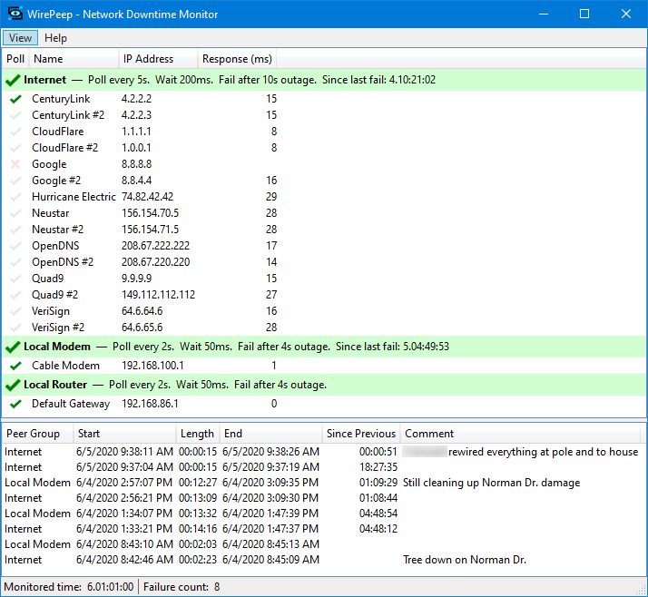
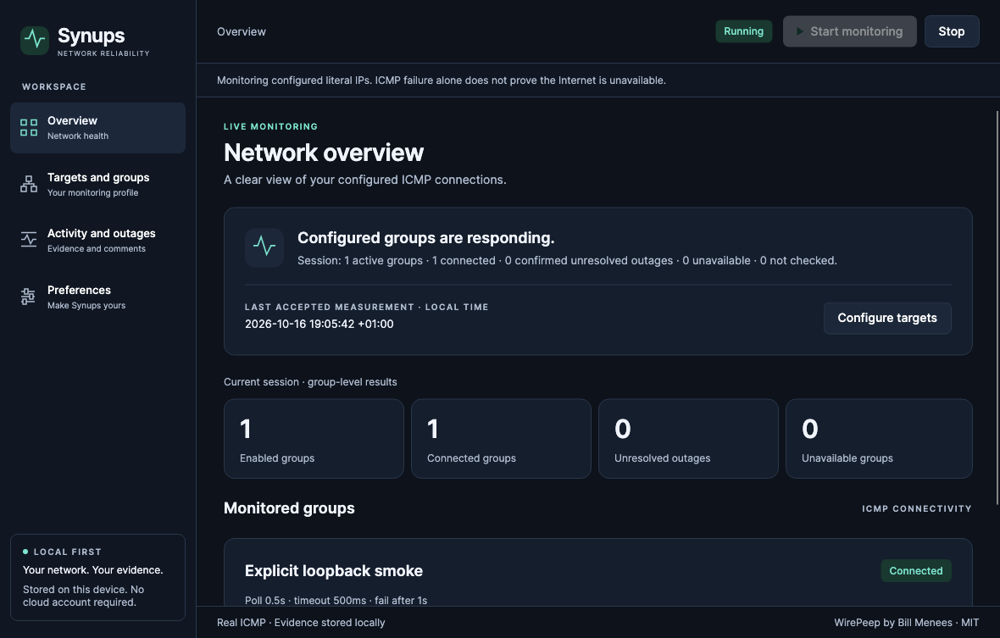

# Synups

Synups is a migration of [WirePeep](https://github.com/menees/WirePeep) into a modern cross-platform network reliability monitor using **real Avalonia, C# and XAML**. Primary competition category: Best IT Pro Tool.

**Current status: reviewed source checkpoint with passing Windows/macOS/Linux CI; release gates remain open.** Synups performs real ICMP monitoring, edits profiles, retains incidents/comments across restarts, writes automatic session logs/statistics and provides configurable alerts and desktop preferences. Native verification harnesses passed on all three OSes; published-executable testing, legacy import and several OS integrations remain incomplete. No production measurements or statistics are fabricated. No backend, cloud service, paid component or WebView is used.

## Build and run

Install the .NET SDK specified in [synups/global.json](synups/global.json) (10.0.402). Avalonia packages are pinned to 12.1.4. From the repository root:

```sh
cd synups
dotnet restore ../Synups.slnx --locked-mode
dotnet build ../Synups.slnx -c Release --no-restore
dotnet test ../Synups.slnx -c Release --no-build
dotnet run --project Synups.Desktop -c Release --no-build
```

Verified on macOS 26.3.1 arm64: 95 deterministic/headless cases, one separately enabled real-network case, native loopback monitoring, durable process restart, minimize/restore and graceful close. Release build has zero warnings/errors. Genuine native client-area captures are included below. See the migration log for scope and failed attempts.

The SDK pin is scoped to synups/ so original WirePeep builds keep their existing SDK selection. Native desktop prerequisites vary by OS; see [platform evidence and risks](docs/migration/CROSS_PLATFORM.md). Windows Server 2025 x64, macOS 15.7.9 arm64 and Ubuntu 24.04.5 x64 passed the [corrected checkpoint CI run](https://github.com/samscript18/Synups/actions/runs/38940757093): locked restore, zero-warning Release build, 95 deterministic/headless cases plus one explicit loopback case per OS, native production-composition harness and self-contained publishing. Linux native UI used Xvfb. Published apphost launches and installed-desktop behavior remain unverified. The run's retained verification artifacts contain Windows ZIP/Unix tar.gz packages, checksums, logs, TRX and client captures; these expire after 30 days and are unsigned verification builds, not a public release. Downloaded packages were checked for exact MIT licence bytes, runtime notices, every file hash and Unix executable mode.

## Use Synups

Monitoring stays stopped when the application opens unless you explicitly save the monitoring-on-launch preference (disabled by default). In **Targets and groups**, add a disabled group, add named literal IPv4/IPv6 targets, then enable the group. Alternatively restore the original WirePeep defaults. Its 15 literal Internet targets and timing values come from the actual upstream XML; three discovery-only local-device groups remain disabled until you add targets. No discovery or network scanning runs.

**Apply group/target** saves each edit immediately. Configuration uses versioned JSON under the OS per-user LocalApplicationData directory in `Synups/configuration.v1.json`; the exact path is shown in the app. Names, IDs, addresses and timing limits are validated. Corrupt files are preserved: retry after fixing them or explicitly recover with defaults, which creates a backup. Original WirePeep settings are never modified. Stop monitoring before editing; moving targets preserves their IDs. Removing the last target disables its group.

Select **Start monitoring**. Overview shows actual group counts, uncertainty and the latest measurement time. A group stops checking peers after the first response; other targets may be stale or not checked. Target rows show last check, last success, real RTT where available and useful errors. ICMP reachability does not establish that all network services work.

**Activity and outages** records confirmed outages, recoveries and probe errors. A probe error makes confidence indeterminate and cannot recover a confirmed outage; only a successful probe does that. Outage duration begins at confirmation, with earlier failed observation recorded separately. Large observation gaps are marked. Stop ends observation without fabricating recovery. History/comments now survive application restart in a separate `history.v1.db` SQLite file. Clean shutdown ends observation without recovery; unclean shutdown is marked interrupted at the last committed observation. A new session never retroactively recovers an older unresolved incident. CSV remains available for sharing.

**Preferences** persist always-on-top, exit confirmation, launch minimized, opt-in monitoring on launch, transition alerts and automatic log options. In-app alerts are labelled as such. Optional native requests use osascript on macOS or notify-send on Linux where available; Windows uses the in-app fallback in this unpackaged build. OS delivery is not guaranteed or verified. The tray offers Show/Exit where available; Linux keeps taskbar access even when a tray host is absent. Closing means save/stop/quit, optionally confirmed. OS login/startup registration and alert sounds are not implemented.

Automatic JSON session logs and outage CSV are derived from committed evidence on Stop/Close and comment changes. They contain actual events, comments and observed-duration summaries, without inferred Internet uptime percentages. Choose an absolute log folder in Preferences. Automatic copies retain their separate **256 MiB cap**; archive them manually or choose another folder when full.

**Preferences → History storage** defaults to **1 GiB**. Stop monitoring and enter **256–10240 MiB** (up to 10 GiB), then **Apply database capacity**. The setting is committed atomically in SQLite and reapplied to its existing page size at each open. Existing Phase 3 databases migrate in place with their records/IDs intact. Lowering below allocated database size is refused; an already oversized legacy database is preserved and shown with its actual effective limit. No capacity change resets history.

Storage information measures main database, WAL, SHM, rollback journal, managed backups and automatic logs in the selected folder. It shows allocated/reusable pages, available database capacity, growth headroom, shared volume free space and 80%/95% warning thresholds. The page limit applies to the **main database**, not total disk consumption or reserved space. External copies and previous log folders are not tracked. Warnings use allocated pages, with at most one warning and one critical escalation per capacity per process; reopening can warn once again. Manual Refresh is available while stopped.

History retention defaults to **0: preserve all**. A positive 1–3650 day period requires confirmation and enables cleanup immediately, at launch and once daily during monitoring. Only fully ended sessions older than the cutoff with no unresolved incidents are eligible; interrupted sessions are kept. **Back up and clean eligible history…** is a separate confirmed manual action that first creates a verified full SQLite backup; backup failure cancels deletion. Deletion frees reusable pages without shrinking the file, so allocation warnings can remain. Derived logs/backups are retained separately.

**Create full history backup…** uses SQLite's backup API and publishes a verified, closed snapshot under `history.v1.db.backups`, without overwriting existing snapshots. It contains sessions, events, outages and comments, including committed WAL state. Preferences/configuration/logs remain separate. CSV export contains outage rows only and is not a database backup. Restore instructions and recovery limits are in the [durability design](docs/migration/ARCHITECTURE.md#capacity-policy-backup-and-recovery).

Capacity/file errors stop monitoring and retain unsaved evidence in memory for Retry; successful persistence is reported only after commit. At the configured page limit, stop, increase capacity, then **Retry history storage**. Increasing capacity is allowed while stopped even with pending writes. Physical disk exhaustion/permissions still require repair; backups/cleanup cannot bypass pending evidence. Keep Synups open until retry succeeds. A log-copy error can be resolved by fixing the directory or explicitly disabling automatic copies.

## Verification

The normal test suite does not require a public IP or run real ICMP. From `synups/`, explicitly run the real loopback probe/engine test:

```sh
SYNUPS_REAL_NETWORK_TESTS=1 dotnet test ../Synups.slnx -c Release --no-build --filter FullyQualifiedName~RealLoopback
```

From the repository root, `python3 eng/native-smoke.py --dotnet /path/to/dotnet --screenshots artifacts/screenshots` verifies native production components, real loopback, two separate process launches with durable sessions, minimize/restore and clean close using temporary configuration/history. Add `--seconds 60` for a one-minute observation per launch. This harness is not compiled into production. The CI matrix runs locked restore, tests, explicit loopback, self-contained publishing, native smoke (Linux under Xvfb), captures and retained command/TRX artifacts. The [corrected run](https://github.com/samscript18/Synups/actions/runs/38940757093) passed all three jobs for source commit `7b75296f97ea62d986e7d16b152dedaabcf999d6`; downloaded logs/TRX/captures and archive contents were inspected. This does not establish published-apphost startup.

Latest local correction verification on macOS arm64: Release build passed with zero warnings/errors; 95 deterministic/headless tests passed. Hosted verification exercised all 96 unique cases per OS across the default suite and separate loopback invocation. One earlier Windows storage-integration deadline failure and its test-isolation correction remain recorded in the [migration log](docs/migration/MIGRATION_LOG.md). See [release readiness](docs/migration/RELEASE_READINESS.md) for remaining gates.

The shared native UI uses a restrained ink/teal theme, compact sidebar navigation, text-labelled connectivity badges and a responsive overview. Configuration, history and preferences use consistent panels; unknown measurements stay unknown. Native OS window controls are retained.

## Migration write-up — work completed so far

Original baseline: [`61ae14391151ca9f209223e62c98fae3df5482b8`](https://github.com/menees/WirePeep/commit/61ae14391151ca9f209223e62c98fae3df5482b8), authored by Bill Menees in June 2024, before the challenge. This repository retains that Git history and the original WPF implementation, solution, build scripts, assets and MIT licence. The original project description is available [at the baseline commit](https://github.com/menees/WirePeep/blob/61ae14391151ca9f209223e62c98fae3df5482b8/README.md).

WirePeep already separates its synchronous ICMP engine into WirePeep.Common. That separation helps, but Common inherits Windows framework targets and couples configuration to Menees settings APIs. Its Profile constructor can perform device discovery. The WPF MainWindow also owns scheduling, outage history, logging and alert orchestration. This migration therefore requires service extraction as well as a presentation rewrite.

Phase 1 kept legacy sources unchanged and created a separate solution with Core, Desktop and Tests. It reuses the original default XML directly as an embedded resource and preserves its address naming and timing values. A new side-effect-free reader replaces Profile construction for configuration inspection. An observable presentation model drives a native resizable Avalonia window with Fluent controls, shared dark-theme tokens, keyboard-selectable navigation and an explicit setup/error state. There is no DI container because manual composition is sufficient for the current scope. Core now contains separate monitoring and persistence services; Desktop contains only orchestration and presentation.

Phase 2 ports name-sorted round-robin polling, stop-on-success, stale samples, fail thresholds, recovery, outage comments, CSV export and profile persistence. Deterministic tests also link original state machines directly. Deliberate changes use monotonic elapsed time, retain outages across probe errors, make mixed-error groups order-independent and drain background work on shutdown. The UI pulls snapshots without a dispatcher backlog. No production simulated measurements are present. Phase 3 keeps the engine and adds SQLite transaction durability, session interruption handling, automatic derived logs, transition alert deduplication, native adapter fallbacks, tray policy and persisted desktop preferences. Durability is a Synups enhancement over WirePeep’s session-only UI. Rollback transactions replace the need to implement a custom torn-write journal. SQLite I/O is serialized off-thread; storage failures retain unsaved batches and block a misleading clean exit. The coarse legacy inventory parity is **72.2%**, calculated as (9 complete + 8 partial × 0.5)/18. Sound, login launch, Windows native alerts, complete single-instance activation, import, discovery and several menu details remain missing. Its rubric is in FEATURE_PARITY.md.

Engineering issues and actual verification results, including failed attempts and fixes, are recorded in the log below. Effort is described through performed work and measured command timings; no development-hour estimate is invented.

- [Original baseline and build evidence](docs/migration/BASELINE.md)
- [Feature implementation inventory and parity](docs/migration/FEATURE_PARITY.md)
- [Legacy state-transition characterization](docs/migration/LEGACY_SEMANTICS.md)
- [Architecture and design decisions](docs/migration/ARCHITECTURE.md)
- [Actual migration log and verification](docs/migration/MIGRATION_LOG.md)
- [Cross-platform evidence and risks](docs/migration/CROSS_PLATFORM.md)
- [Roadmap and remaining submission gates](docs/migration/ROADMAP.md)
- [Release readiness checklist](docs/migration/RELEASE_READINESS.md)
- [Discovery and legacy import investigation](docs/migration/LEGACY_INTEGRATIONS.md)

## Screenshots and challenge readiness

[Evidence provenance and reproduction](docs/evidence/README.md) distinguishes the author’s original published illustration from our live native client-area captures. No screenshot values were fabricated. A fresh WPF capture requires Windows; OS window-chrome/desktop capture remains unavailable in this session.

| Before — upstream WirePeep illustration, Bill Menees | After — Synups, macOS arm64, real loopback |
|---|---|
|  |  |

These are different measurement environments and times, not a comparative connectivity benchmark. The Synups capture renders the actual visible native client tree via Avalonia, without OS chrome. Additional native client captures from Windows/macOS/Linux are retained in the verified CI artifacts. Published executable launch validation, installed-desktop testing, signing/packaging and remaining checklist gates are required before a release.

The [Avalonia Port Challenge](https://avaloniaui.net/blog/avalonia-port-challenge) closes October 23, 2026 at 23:59 UTC. Synups is not a finished competition entry. No submission or publication was performed.

## Licence and attribution

[MIT](LICENSE). Original WirePeep copyright (c) 2020 Bill Menees; the original licence remains verbatim. Original source/resource notices remain intact. Synups is a derivative migration and does not claim authorship of WirePeep. Avalonia and bundled font dependencies retain their respective package licences.
