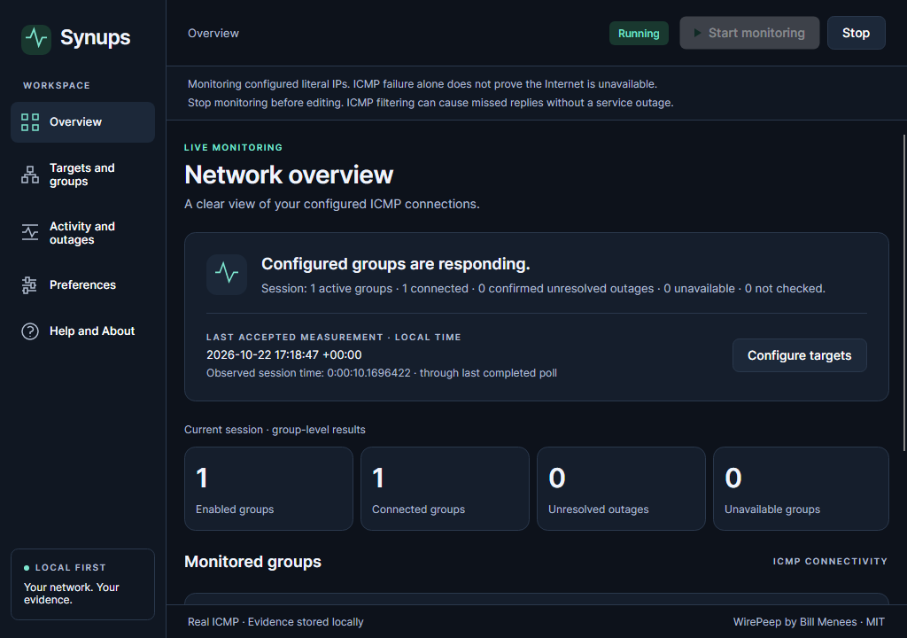
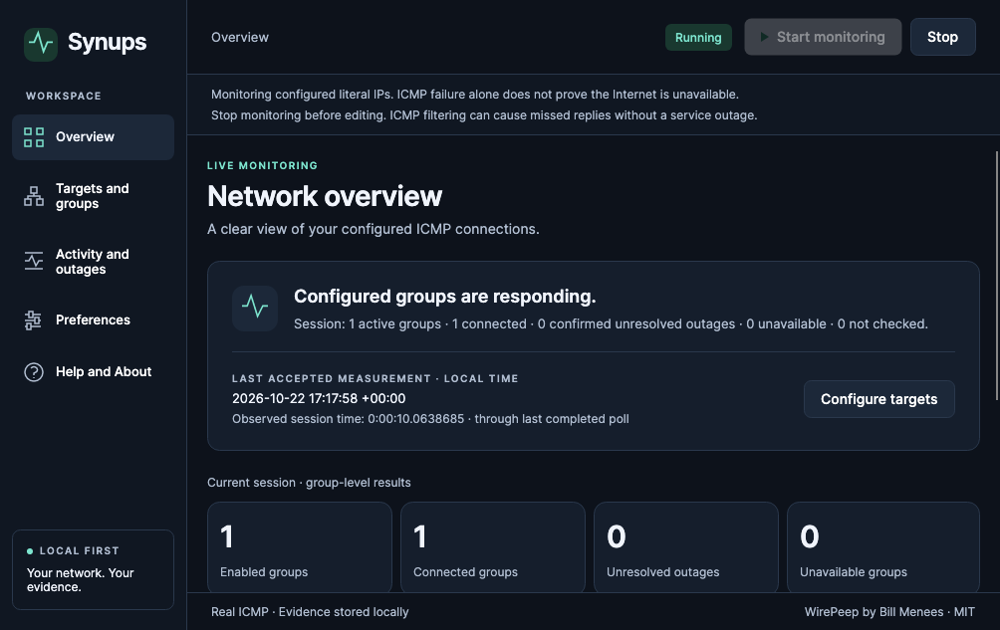

# Synups

**Know when your network drops. Know how long it lasts. Keep the evidence.**

Synups is a local-first network reliability monitor for Windows, macOS and Linux. Monitor the peers you choose, record confirmed ICMP outages and observed recoveries, and keep incident timelines, comments and troubleshooting evidence in local SQLite.

Use it to investigate intermittent connectivity, maintain a local incident history, and export records when discussing a problem with your IT team or ISP. A failed ICMP check describes reachability to configured peers; it does not establish that the entire Internet is down.

Built with **Avalonia, C# and XAML**, migrating [Bill Menees’ WirePeep](https://github.com/menees/WirePeep) for the [2026 Avalonia Port Challenge](https://avaloniaui.net/blog/avalonia-port-challenge), targeting **Best IT Pro Tool**. No account, backend or cloud service is required.

## Download

**Public release: [v0.1.0](https://github.com/samscript18/Synups/releases/tag/v0.1.0).** These permanent downloads require neither a GitHub account nor a .NET SDK. Extract the complete archive and keep its files together.

| Platform | Download | Launch / installation note |
|---|---|---|
| Windows x64 | [ZIP](https://github.com/samscript18/Synups/releases/download/v0.1.0/Synups-win-x64.zip) | `Synups.exe` — unsigned; Windows or organizational policy may warn/block. |
| macOS arm64 | [tar.gz](https://github.com/samscript18/Synups/releases/download/v0.1.0/Synups-osx-arm64.tar.gz) | `Synups.app` — ad-hoc integrity only, **not notarized; Gatekeeper rejects trusted distribution**. Read the [installation guidance](docs/release/INSTALLATION.md). |
| Linux x64 | [tar.gz](https://github.com/samscript18/Synups/releases/download/v0.1.0/Synups-linux-x64.tar.gz) | `./Synups` — retain executable permissions; native desktop libraries are required. |

Verify downloads against [SHA256SUMS](https://github.com/samscript18/Synups/releases/download/v0.1.0/SHA256SUMS). The runtime, Avalonia, SQLite, licences and dependency notices are bundled. Do not disable operating-system security protections.

**Proposed public v0.1.1 payload: frozen 0.1.1-rc.3, unpublished.** It adds guided setup, safe discovery and desktop conveniences and reaches **88.9% legacy parity**. [Candidate review, exact hashes and evidence](docs/release/LEGACY_COMPLETION_CANDIDATE.md). The [proposed v0.1.1 release](docs/release/v0.1.1/RELEASE_BODY.md) uses those frozen binaries; publication awaits authorization. Public download links above still serve v0.1.0. A separate [rc.4 integration candidate](docs/release/DESKTOP_COMPLETION_CANDIDATE.md) now verifies genuine WirePeep profile import, optional WAV requests and log/pane preferences on all three OS runners (**91.7% inventory parity**); it does not silently replace the proposed rc.3 payload.

## See Synups

These genuine captures show the verified **rc.3 candidate**, not mock data. The overview uses real loopback ICMP; the incident uses controlled packet filtering in an isolated Linux namespace, not an ISP outage.


| Windows | macOS | Linux / X11 |
|---|---|---|
|  |  |  |

[Fresh first run](docs/evidence/after/2026-10-22-legacy-completion/osx-arm64/first-run.png) · [Actual Mac OS window](docs/evidence/after/2026-10-22-legacy-completion/macos-normal-launch.png) · [Real incident demonstration](docs/competition/INCIDENT_DEMO.md) · [Screenshot provenance](docs/evidence/README.md)

## Features and practical uses

- **Diagnose intermittent reachability:** real finite-timeout ICMP, configurable peer groups, polling intervals and failure grace.
- **Keep useful evidence:** confirmed incidents, observed recoveries, comments, interrupted sessions and local SQLite history across restarts.
- **Understand uncertainty:** connected, disconnected, unavailable, stale and not-checked states; actual RTT only after a successful probe.
- **Share troubleshooting records:** chronological UTC CSV, automatic JSON/CSV session logs and observed-duration summaries.
- **Configure your own monitoring:** named IPv4/IPv6 targets, group membership, persistent settings and guided first-target setup.
- **Use desktop controls:** Start/Stop, window preferences, clipboard/context actions, Help, transition alerts and safe tray/restoration behavior.
- **Discover deliberately in rc.3:** inspect native gateway candidates or explicitly check the original modem/transceiver addresses, then confirm before adding. No subnet scan, network change or startup discovery.

Some conveniences are candidate-only; the [version-specific inventory](docs/migration/FEATURE_PARITY.md) distinguishes them from public v0.1.0.

## Quick start

1. Extract and launch the platform package, following its installation guidance.
2. In rc.3, enter a group name, target name and a literal IP you are authorized to monitor, then choose **Add target and create group**. In v0.1.0, use **Targets and groups** to create the group and target.
3. Choose **Start monitoring**. Opening Synups does not probe automatically unless you deliberately enable monitoring on launch.
4. Review live results, then **Activity and outages** for confirmed incidents. Add comments and export CSV when records exist.
5. Stop before editing configuration. Settings and recorded evidence survive a clean restart.

A peer group contains alternative targets: probing stops after its first success. Other members may remain stale or not checked. If ICMP is filtered or permission is denied, inspect the error and try an authorized responsive peer; missing replies alone do not identify the cause.

## From WirePeep to Synups

| Original WirePeep | Synups |
|---|---|
| Windows WPF, .NET Framework/Windows-targeted .NET and Menees desktop integrations | Avalonia desktop UI on Windows, macOS and Linux |
| WPF window owns scheduling, state presentation, logging and alerts | UI-free Core services, observable presentation and explicit OS boundaries |
| Synchronous probes and wall-clock timing | Bounded asynchronous groups, finite cancellation and monotonic elapsed timing |
| Sorted rotating peers, stop on success, failure grace and outage comments | Those intents preserved and characterized against original source |
| Session-memory outage list and text logs | Durable SQLite incidents/comments, bounded history pages, streaming CSV and backups |
| Unavailable results could clear failures | Errors remain indeterminate; only observed success recovers an incident |

| Before: original WirePeep on Windows | After: actual rc.3 Avalonia client |
|---|---|
|  |  |

The original was freshly built from preserved upstream `61ae143` and captured on a disposable Windows runner with outbound traffic blocked for that executable. Its failed replies are controlled test results, not an ISP outage. [Original run](https://github.com/samscript18/Synups/actions/runs/39841203591) · [Before/after provenance](docs/evidence/README.md). The attributed upstream illustration is also retained.

## Migration challenges and accomplishments

WirePeep.Common inherited Windows targets and depended on Menees configuration/discovery. Its WPF window also coordinated monitoring, logging, alerts and lifetime. Replacing the UI alone would not make the application portable.

**What translated cleanly?** Literal-IP models, peer/group identity, sorted round-robin selection, stop-after-success, failure grace and outage/comment intent. The original default XML is reused; five linked-original characterization tests protect its state/rotation behavior.

**What needed rethinking?** Presentation and platform integration were rewritten in Avalonia. Monitoring gained owned cancellation and bounded concurrency; UTC timestamps remain evidence while monotonic time governs durations. Probe errors and shutdown cannot invent recovery. SQLite reload, interruption handling, storage safeguards, paginated incidents and streaming export extend the original session-only evidence.

**What surprised us?** Native minimize/restoration required a real Linux window manager, Mac archive handling affected signature integrity, Windows cold route queries needed bounded startup allowance, async UI actions could lose focus, and SQLite write failures required retaining evidence through shutdown. Actual failures and fixes are retained in the [migration log](docs/migration/MIGRATION_LOG.md).

**What did it cost?** Repository sessions began **16 October 2026**; the frozen rc.3 application was committed **22 October**. It contains **29 commits** after upstream `61ae14391151ca9f209223e62c98fae3df5482b8` (1 June 2024): reproduce with `git rev-list --count 61ae14391151ca9f209223e62c98fae3df5482b8..7ca85cccce6e3609d08d64e4f23172fa14fffb25`. Work was AI-assisted. No total developer hours were measured or invented; command timings are not labor hours.

[Judge’s guide](docs/competition/JUDGES_GUIDE.md) · [Baseline](docs/migration/BASELINE.md) · [Exact legacy semantics](docs/migration/LEGACY_SEMANTICS.md) · [Migration log](docs/migration/MIGRATION_LOG.md)

## Platform verification

Frozen rc.3 application: **7ca85cccce6e3609d08d64e4f23172fa14fffb25**. [Successful three-OS run](https://github.com/samscript18/Synups/actions/runs/39821153798).

| Actual environment | Default tests | Separate real/native checks | Extracted executable |
|---|---:|---:|---|
| Windows Server 2025 x64 |143 passed|3 passed|Six stages passed|
| macOS 15 arm64 |143 passed|3 passed|Six stages passed|
| Ubuntu 24.04 x64, Xvfb + Openbox |144 passed|3 passed|Six stages passed|

Each OS also passed eight Python safety tests, locked restore/auditing and zero-warning Release builds. There are **147 unique .NET cases**: three opt-in and one Linux-only Gio test, explaining the intentional default/platform skips. Actual packaged apphosts verify native windows, minimized/restored state, clipboard, real loopback, configuration, SQLite restart/interruption and read-only error/repair. Five normal exits are zero; deliberate process termination is recorded separately.

[CodeQL](https://github.com/samscript18/Synups/actions/runs/39821182932) retained zero SARIF results; scoped coverage is **80.81% lines / 67.34% branches**. [Reports and hashes](docs/evidence/verification/2026-10-22-legacy-completion-final.json). These tests drive real controls programmatically; they are not physical tray/keyboard/native Save-panel certification. Earlier endurance evidence retains its own source qualification.

**Separate rc.4:** [run39850198899](https://github.com/samscript18/Synups/actions/runs/39850198899) passes159 default cases on Windows/Mac and160 on Linux, plus3 real/native and1 audio-request/fallback case per OS,8 Python cases and six extracted-apphost stages. There are164 unique .NET cases. Windows native notification delivery failed independent observation and that adapter was withdrawn; in-app alerts remain. [Exact source, hashes, retained failure and verification](docs/release/DESKTOP_COMPLETION_CANDIDATE.md).

Public v0.1.0 remains pinned to `2973d3349fcb5af5639597920842288e6549bbd0`: [105 default +1 opt-in per OS and packaged verification](https://github.com/samscript18/Synups/actions/runs/39682197118), [anonymous release verification](docs/evidence/verification/synups-0.1.0-publication.json). [Full platform matrix](docs/migration/CROSS_PLATFORM.md).

## Legacy parity

**Verified rc.3: (14 complete + 4 partial × 0.5) / 18 = 88.9%.** Public v0.1.0 remains72.2%; earlier candidate results are historical, not retroactive binary upgrades.

For the proposed rc.3 payload, the four partial areas are **alerts**, **preferences**, **placement/tray** and **genuine WirePeep settings import**. Separately verified rc.4 closes the profile-import gap using a fixture emitted by the untouched original Windows executable: **(15 complete +3 partial×0.5)/18=91.7%**. Actual OS notification/login execution and physical tray/multiple-display acceptance remain gaps. This is a coarse functional inventory, not percent effort or universal platform certification. [Unchanged18-item rubric](docs/migration/FEATURE_PARITY.md).

## Known limitations

- **Distribution trust:** Windows is unsigned; Mac ad-hoc integrity is not Developer ID signing/notarization and Gatekeeper rejects it. Linux proof is X11/Xvfb, not every Wayland desktop. [Installation](docs/release/INSTALLATION.md), [signing findings](docs/release/DISTRIBUTION_TRUST.md).
- **Desktop acceptance:** macOS Accessibility/event-post permission prevents physical tray, keyboard and native Save-panel automation. [Exact human acceptance checklist](docs/release/MACOS_ACCEPTANCE.md). Native notification request acceptance does not establish delivery.
- **Evidence semantics:** ICMP is not universal Internet health. Unobserved intervals stay uncertain; stopping never recovers an incident. No fabricated uptime or historical latency series exists.
- **Data safety:** forced quit can lose uncommitted batches. Pending write failures require repair/Retry. CSV is not a full database backup; use the SQLite backup action. [Storage design](docs/migration/ARCHITECTURE.md).
- **Scope:** broader IPv6/VPN/suspend/multi-display/long-running GUI acceptance, broader settings-format compatibility and remaining OS integrations need work. This is not a production-readiness or100%-parity claim.

## Architecture and development

Three projects: **Synups.Core** (configuration, monitoring, persistence), **Synups.Desktop** (Avalonia/MVVM and OS integration), **Synups.Tests** (characterization, deterministic and headless tests). No WebView, backend or production mock probe. [Architecture](docs/migration/ARCHITECTURE.md) · [Release checklist](docs/migration/RELEASE_READINESS.md).

With the pinned .NET10.0.402 SDK and Avalonia12.1.4:

```sh
cd synups
dotnet restore ../Synups.slnx --locked-mode
dotnet build ../Synups.slnx -c Release --no-restore
dotnet test ../Synups.slnx -c Release --no-build
dotnet run --project Synups.Desktop -c Release --no-build
```

The default tests do not require a public endpoint. Explicit native/network checks: set `SYNUPS_REAL_NETWORK_TESTS=1` and filter `FullyQualifiedName~RealLoopback|FullyQualifiedName~RealDefaultGateway`. Original `WirePeep.sln` and source remain separate. Local data paths and workspace selection are described in [installation](docs/release/INSTALLATION.md).

## Licence, attribution and acknowledgements

[MIT licence](LICENSE). Original WirePeep and resources: **Bill Menees**. The original source, copyright notices and [upstream ancestry](https://github.com/menees/WirePeep/commit/61ae14391151ca9f209223e62c98fae3df5482b8) are preserved. Bundled third-party licences/notices accompany every package. Thanks to Avalonia and the original library maintainers.

[Prepared competition information](docs/release/SUBMISSION.md) answers the submission questions. Synups is built for the challenge; no official entry or acceptance is claimed. Publishing a newer release and submitting the form require separate authorization.
