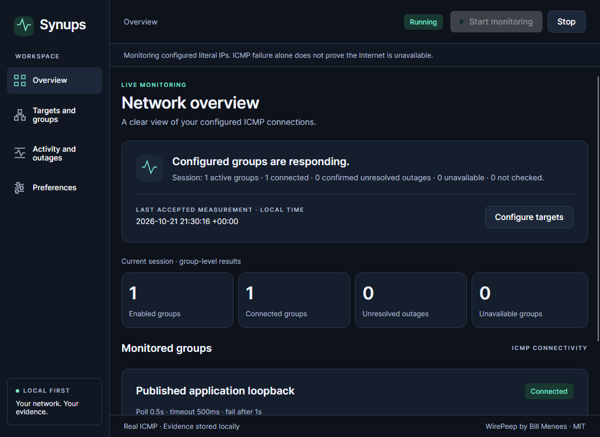
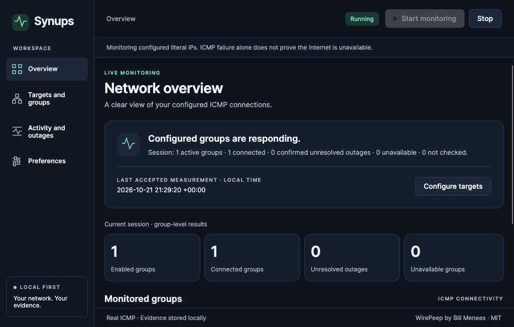
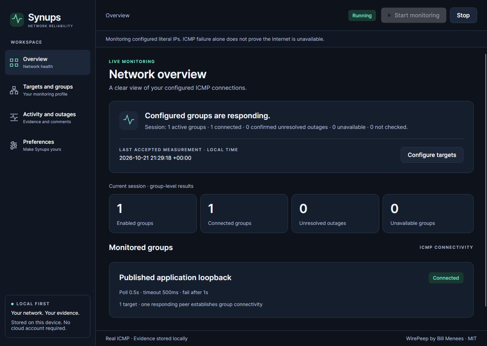

# Synups

A local-first network reliability monitor for Windows, macOS and Linux, built with **Avalonia, C# and XAML**. Synups is a migration of [Bill Menees’ WirePeep](https://github.com/menees/WirePeep), preserving its Git history, MIT licence and peer-group monitoring intent.

**Release candidate, not a production-readiness claim.** Actual self-contained executables are exercised on native Windows/macOS runners and Linux under Xvfb. Signing, everyday desktop/accessibility coverage and final distribution still have explicit limits. There is no WebView, backend, account or cloud service, and no fabricated monitoring data.

## Download and run

Use a successful exact-SHA [Synups verification run](https://github.com/samscript18/Synups/actions/workflows/synups.yml), then download the matching artifact and extract the inner archive under `packages/`. Its adjacent `.sha256` and `ARTIFACT_MANIFEST.json` identify the exact files/source. **GitHub login may be required; CI downloads expire after 30 days.** No public GitHub Release has been published by this migration task. The [verified candidate artifact index](docs/release/VERIFIED_ARTIFACTS.md) pins download links/hashes. See [release materials](docs/release/RELEASE_NOTES.md), [installation instructions](docs/release/INSTALLATION.md) and the [reviewed publication handoff](docs/release/PUBLICATION.md). The frozen Phase 5 application candidate is **2973d3349fcb5af5639597920842288e6549bbd0**; later documentation commits do not replace its audited archives. [Prepared entry information](docs/release/SUBMISSION.md) remains unsubmitted.

| Candidate | Start the extracted application | Actual verification scope |
|---|---|---|
| Windows x64 ZIP | `Synups.exe` | Windows Server 2025 CI; ordinary Windows desktops need further acceptance review. Unsigned publisher. |
| macOS arm64 tar.gz | `Synups.app`, or `./Synups.app/Contents/MacOS/Synups` | macOS 15 CI and local macOS 26.3.1. Ad-hoc integrity signature only; no Developer ID/notarization or Gatekeeper trust. |
| Linux x64 tar.gz | `./Synups` | Ubuntu 24.04/X11 under Xvfb; real desktops and Wayland need separate checks. Native display/font/graphics libraries required. |

The .NET runtime, Avalonia native assets and SQLite are included. Keep the entire extracted folder/bundle together. An SDK is unnecessary for these packages. Installers, Intel Mac/ARM Windows/Linux builds and trusted publisher signatures are not provided. Do not disable OS security to run a candidate.

## What it does

- Real ICMP checks with finite timeouts, actual response latency and typed errors.
- Editable literal-IP targets, peer groups, intervals, failure grace and enablement; atomically saved profiles.
- Live status that distinguishes connected, disconnected, unavailable, stale and not checked.
- Confirmed incidents, observed recoveries, comments and sessions retained in local SQLite; quoted UTC CSV export.
- Automatic JSON/CSV session logs and observed-duration summaries, configurable log location, database capacity, backups and conservative retention.
- Desktop preferences, transition alerts, tray policy and per-workspace single-instance restoration. Windows uses a clearly labelled in-app notification fallback; optional macOS/Linux native requests do not guarantee OS delivery.

Opening the app stays stopped unless you explicitly save monitoring-on-launch. Add a group and a named literal IP, enable/apply it, then Start. Stop before editing. Restoring WirePeep defaults reuses the original XML addresses/timings; discovery-only groups remain disabled. No discovery or subnet scanning runs.

A group stops probing after its first responding peer. Other peers can be stale/not checked; one response does not prove every target or Internet service is online. Probe errors reduce confidence and cannot recover an outage. Stop/close ends observation without inventing recovery; a new session never retroactively recovers an older incident.

Data stays under the per-user `.NET LocalApplicationData/Synups` folder; paths are shown in-app. `--data-directory ABSOLUTE_PATH` selects an independent local workspace. Original WirePeep settings are not modified. Pending write failures retain unsaved evidence in memory and require repair/Retry. A forced quit can lose uncommitted batches. Use the full SQLite backup action; outage CSV is not a database backup. Storage/retention and recovery details: [architecture](docs/migration/ARCHITECTURE.md).

## Genuine application captures

These are actual published-apphost client-area renders from explicit real loopback observations, not mock dashboards or OS desktop screenshots. The measurements are not an Internet benchmark. Exact source, hashes and limits are in the [evidence records](docs/evidence/README.md).

| Windows | macOS | Linux / Xvfb |
|---|---|---|
|  |  |  |

[Before: original WirePeep illustration](docs/evidence/before/wirepeep-upstream.png), published by Bill Menees and retained with attribution. It is an upstream illustration, not a freshly captured Windows baseline run. [Before/after provenance](docs/evidence/README.md) preserves that distinction.

## Verification and remaining gates

[Cross-platform evidence](docs/migration/CROSS_PLATFORM.md) records exact commits, actual run/job links and downloaded artifact hashes. The workflow separately performs locked restore/audit, zero-warning Synups Release build, 105 deterministic/headless cases, the separately enabled real-loopback case, four archive/licence checks, self-contained packaging, **extracted apphost execution**, and the older component-native harness. The default suite intentionally skips its one opt-in network case; all 106 unique .NET cases are exercised across the two invocations.

The actual apphost check drives the normal app’s controls and real services in isolated data: configuration CRUD/validation, real loopback, Stop, preferences, second-process restoration, clean restart, explicit forced termination, interrupted-history reload without recovery, real read-only SQLite error and repair. It checks the executing PID/path/hash, bundled runtime location, native window handle, SQLite integrity and exit codes. Test harness assemblies are excluded from packages. This is programmatic control automation, not physical keyboard/mouse, native save-picker, tray-menu, screen-reader or notification-delivery certification.

A [two-hour real-Core observation](docs/evidence/verification/2026-10-21-engine-endurance-macos-arm64.json) passed with 28,792 loopback probes, no failures/errors, 1.07% mean CPU on one core, 85.5 MiB peak RSS and clean stop/restart/reopen. Source/build qualification is explicit; this is not multi-hour GUI or leak-free certification. Two separate five-minute published-GUI observations are recorded independently.

The [release checklist](docs/migration/RELEASE_READINESS.md) is authoritative for current readiness. The [desktop acceptance protocol](docs/release/DESKTOP_VALIDATION.md) lists remaining human checks. Known gaps include trusted macOS delivery, physical tray/notification/accessibility review, broader IPv6/VPN/suspend/permissions coverage, representative large-history/long-running GUI workloads, validated legacy settings import, bounded discovery, login registration, sound/taskbar/focus parity and legacy clipboard/help details. Windows native notifications use the documented fallback. No multi-platform production-support or full legacy-parity claim is made.

## Build from source

Pinned SDK: .NET 10.0.402; Avalonia 12.1.4. From the repository root:

```sh
cd synups
dotnet restore ../Synups.slnx --locked-mode
dotnet build ../Synups.slnx -c Release --no-restore
dotnet test ../Synups.slnx -c Release --no-build
dotnet run --project Synups.Desktop -c Release --no-build
```

The SDK pin is scoped to `synups/`; the original `WirePeep.sln` remains separate. The test suite does not depend on a public IP. Explicit opt-in networking: set `SYNUPS_REAL_NETWORK_TESTS=1` and filter `FullyQualifiedName~RealLoopback`. Reproducible package/apphost/resource checks are in `eng/`; platform prerequisites and usage are documented with the evidence.

## Migration write-up

Original baseline: [61ae14391151ca9f209223e62c98fae3df5482b8](https://github.com/menees/WirePeep/commit/61ae14391151ca9f209223e62c98fae3df5482b8), June 2024, before this challenge. Original source, WPF solution/build scripts, assets, licence and commit ancestry remain. [Original README](https://github.com/menees/WirePeep/blob/61ae14391151ca9f209223e62c98fae3df5482b8/README.md).

WirePeep.Common separated useful monitoring logic, but inherited Windows frameworks and coupled configuration to Menees settings/discovery. The WPF window also owned scheduling, logging, outages and alerts. Reusing Common unchanged would not produce an independent cross-platform engine. The migration therefore reuses its default XML and characterized algorithms, ports monitoring intent, and rewrites presentation/lifetime and platform boundaries.

The solution has three projects: **Core** for configuration, monitoring and persistence; **Desktop** for Avalonia MVVM and OS integrations; **Tests** for linked-original characterization, deterministic regressions and headless UI. Manual composition suffices; no DI framework, backend or extra production project was introduced. Independent async groups preserve sorted round-robin selection and stop-on-success with bounded concurrency. Monotonic timing governs intervals/durations, with UTC evidence and explicit uncertainty/freshness.

Intentional corrections are tested and documented: unavailable/error results cannot falsely recover a confirmed outage, mixed failure/error groups become indeterminate, large observation gaps reset unconfirmed failure grace, and ordinary shutdown cannot manufacture recovery. Durable SQLite reload, interrupted-session records, backups/capacity safeguards and group enablement are Synups enhancements. [Exact legacy semantics](docs/migration/LEGACY_SEMANTICS.md) and [parity inventory](docs/migration/FEATURE_PARITY.md) distinguish them from retained functionality; conservative inventory parity remains **72.2%**, not an effort estimate.

Actual difficulties include Windows-only baseline execution, first-time SDK/NuGet restrictions, xUnit version compatibility, real storage/deadline contention, truthful unavailable-state migration, safe pending-write shutdown, failed screenshot capture, an action-readiness race, Windows licence newline conversion, macOS archive signature loss and native minimize/restoration behavior. These failures and tested corrections remain in the [migration log](docs/migration/MIGRATION_LOG.md). Native component execution was explicitly kept separate from later published-executable proof. Code-authored icons and a macOS bundle now establish identity without claiming publisher trust.

This is AI-assisted repository work across interrupted sessions. No total development hours were instrumented or invented. Command timings and measured observations are evidence, not labor hours. The [baseline](docs/migration/BASELINE.md), [architecture](docs/migration/ARCHITECTURE.md), [platform matrix](docs/migration/CROSS_PLATFORM.md), [migration log](docs/migration/MIGRATION_LOG.md), [roadmap](docs/migration/ROADMAP.md) and [release checklist](docs/migration/RELEASE_READINESS.md) retain actual scope and outstanding work. No public release or competition entry is submitted automatically.

## Licence and attribution

The original [MIT licence](LICENSE), Bill Menees’ copyright/attribution and upstream Git history are preserved. Distributed candidates include runtime/native/font dependency notices and their publisher texts. Synups targets the Avalonia Port Challenge’s Best IT Pro Tool category, with Cross-Platform Port and Legacy Revival as secondary aims. It does not imply endorsement by WirePeep’s author or Avalonia.
