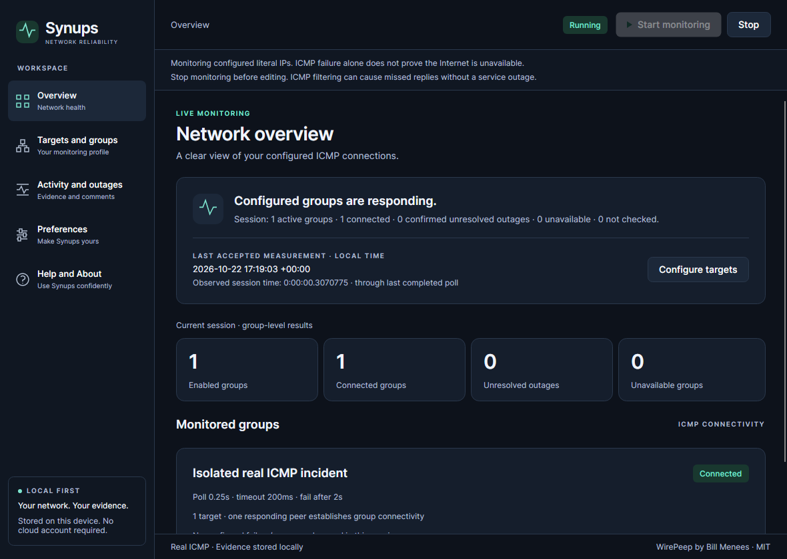
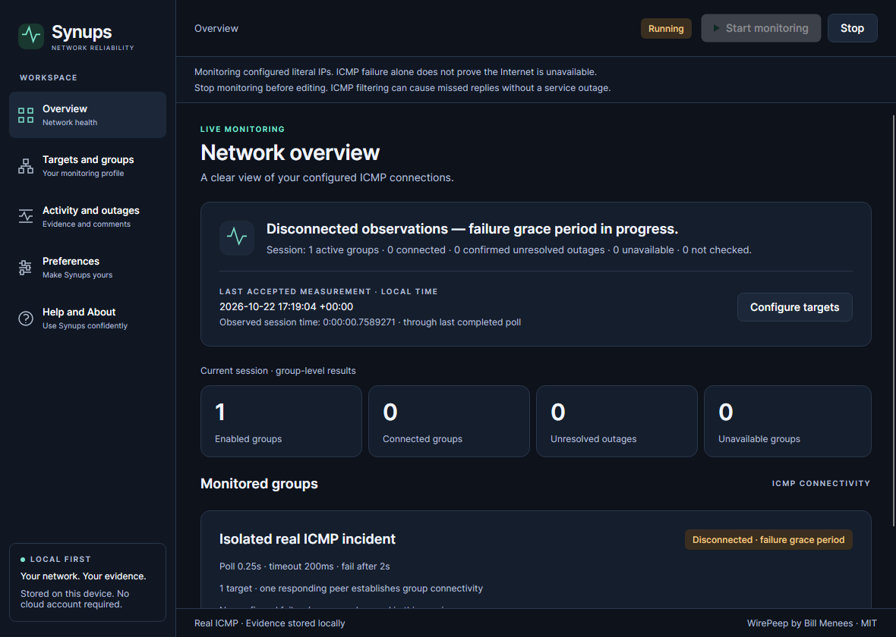
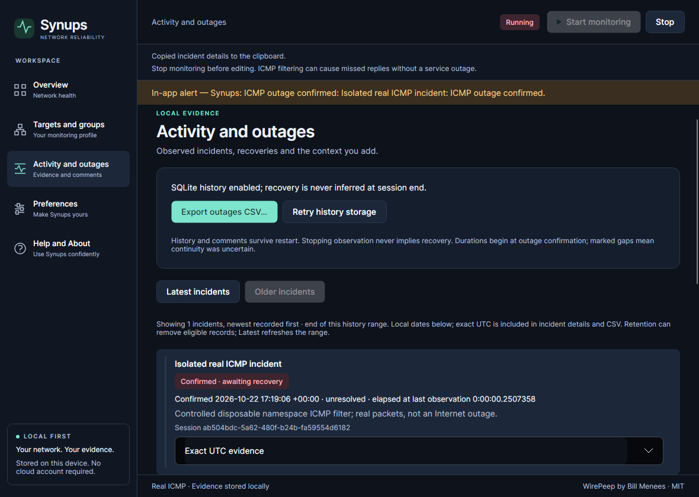
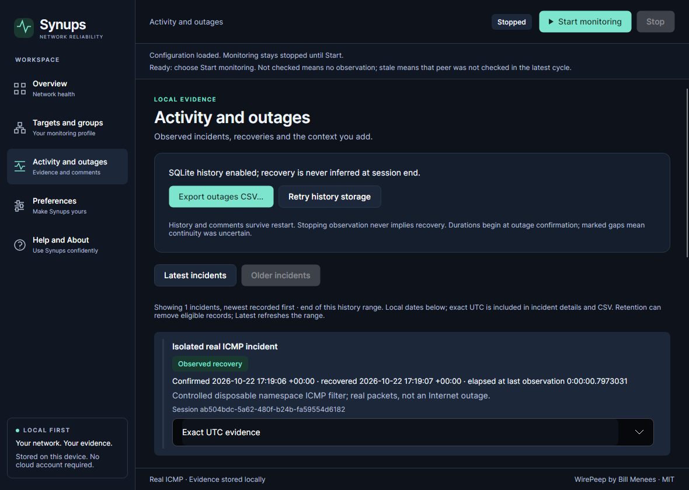

# A real incident, from missed replies to saved evidence

These are unchanged genuine captures from production IcmpProbe/MonitoringService and the native Avalonia source-component UI, source **7ca85cccce6e3609d08d64e4f23172fa14fffb25**, in [Windows/macOS/Linux verification run39821153798](https://github.com/samscript18/Synups/actions/runs/39821153798). The incident itself ran in a **disposable Linux network namespace** under Xvfb/Openbox. A kernel rule temporarily dropped real loopback ICMP replies, then was removed. The user's host network was not modified. This is controlled ICMP reachability failure, **not an ISP outage**, a fake probe or an animation reconstructed from invented frames.

## 1. Monitor an explicitly configured peer

Target127.0.0.1 is explicitly configured for this isolated experiment. Actual replies establish initial reachability. No unsolicited external target is probed.

## 2. Missed replies enter failure grace

First failure: **2026-10-22T17:19:04.425587Z**. The configured2s grace has not yet elapsed, so the UI must not invent a confirmed incident immediately. The kernel filter, not an injected result, causes the loss.

## 3. Confirm and annotate the incident

Confirmed start: **17:19:06.6648923Z**. Incident ID`342ee686-7523-43e7-a6c2-a9bd6f252021`. The explicit comment records the controlled environment: “Controlled disposable namespace ICMP filter; real packets, not an Internet outage.” One confirmed transition creates one incident.

## 4. Observe genuine recovery

After removing the isolated filter, real success was observed at **17:19:07.4621134Z**. Monotonic duration since confirmation: **0.7973031s**. This excludes pre-confirmation grace, matching documented legacy logging intent. UTC records retain exact timestamps; elapsed time is not calculated by trusting adjustable wall clocks.

## 5. Restart and export the evidence

Restart retains the same incident ID, comment and observed recovery, with exactly one outage/recovery event. [Actual CSV](../evidence/verification/2026-10-22-legacy-completion-incident/real-incident.csv) was exported by the production exporter and checked against the stored incident. That verifies export content; it does **not** certify physical interaction with an OS Save panel. [Native Save-panel human checklist](../release/MACOS_ACCEPTANCE.md).

[Original incident record](../evidence/verification/2026-10-22-legacy-completion-incident/incident.json) · [Reload record](../evidence/verification/2026-10-22-legacy-completion-incident/restart.json) · [Namespace actions and every capture/file hash](../evidence/verification/2026-10-22-legacy-completion-incident/namespace-evidence.json) · [Reproduction protocol](REAL_INCIDENT.md)

The component-native incident demonstration is separate from the six-stage **actual extracted executable** checks on each OS. No synthetic frames, interpolation, invented measurements, outage video or physical-desktop certification is implied. This screenshot sequence deliberately preserves the recorded evidence rather than simulating a live session.
