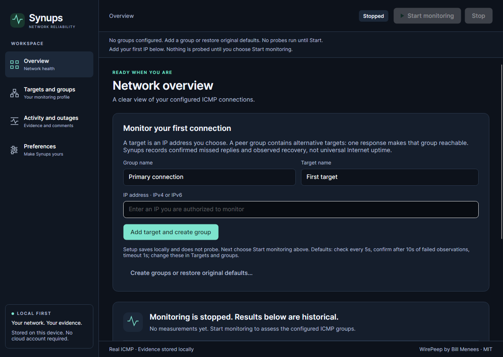
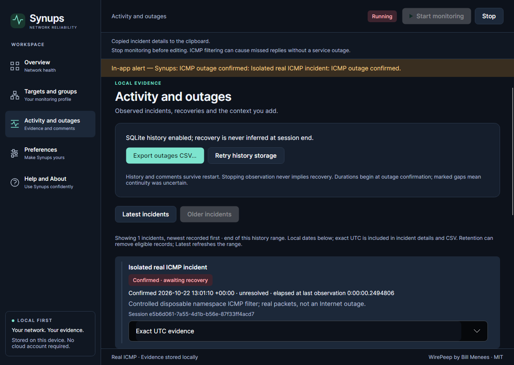
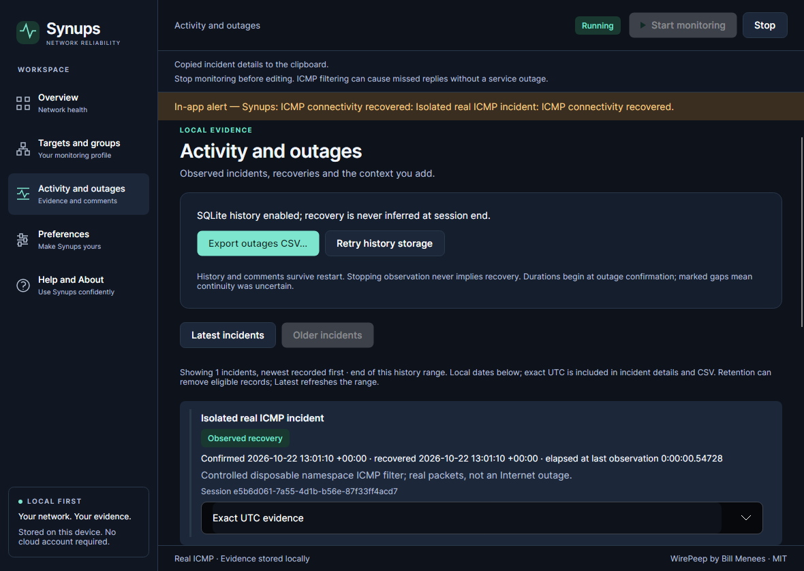

# Synups — judge’s guide

Synups helps developers and IT professionals retain evidence of intermittent connectivity problems: real ICMP observations, confirmed incidents, observed recoveries and context in a local database. Primary category: **Best IT Pro Tool**. No cloud account, backend, WebView, production simulator or fabricated uptime.

## Exact runnable release

**[Synups 0.1.0](https://github.com/samscript18/Synups/releases/tag/v0.1.0)** — source/tag `2973d3349fcb5af5639597920842288e6549bbd0`. [Windows x64](https://github.com/samscript18/Synups/releases/download/v0.1.0/Synups-win-x64.zip), [macOS arm64](https://github.com/samscript18/Synups/releases/download/v0.1.0/Synups-osx-arm64.tar.gz), [Linux x64](https://github.com/samscript18/Synups/releases/download/v0.1.0/Synups-linux-x64.tar.gz), [SHA256SUMS](https://github.com/samscript18/Synups/releases/download/v0.1.0/SHA256SUMS). The runtime and native SQLite are included; keep every extracted file together. All 15 Release assets were anonymously downloaded/hash-verified. [Publication evidence](../evidence/verification/synups-0.1.0-publication.json), [installation](../release/INSTALLATION.md).

The later **0.1.1-rc.1 is an unpublished candidate**, not a replacement for those verified assets. It adds one-action first-target setup; only its separately recorded CI/source results apply to it. No new Release or competition entry is published automatically.

## Original application and preserved behavior

Bill Menees’ MIT-licensed [WirePeep](https://github.com/menees/WirePeep) existed before the challenge: upstream `61ae14391151ca9f209223e62c98fae3df5482b8` (2024) remains an ancestor, with original WPF source/build files and licence retained. WirePeep checked named literal-IP peers in groups, rotated the first peer, stopped after a response, applied failure grace, and recorded session outages/comments/logs.

Synups preserves that monitoring intent and the original literal default XML. Five linked-original characterization tests isolate its state/rotation code; migrated tests cover the documented corrections. One responding peer means group reachability, not that every peer is online. Unprobed targets remain not checked/stale.

## What was rewritten and improved

| Area | Original | Migration result |
|---|---|---|
| Presentation | WPF/Menees controls and window orchestration | Native Avalonia C#/XAML, observable rows and shared design tokens |
| Monitoring | Blocking probes/timer, mutable UI coupling | UI-free snapshots, async bounded workers, cancellation/drain and immutable session configuration |
| Time and uncertainty | UTC thresholds; unavailable could clear failure | Monotonic durations; errors never imply recovery; gaps explicitly marked |
| Evidence | In-memory session list and text logs | Transactional SQLite incidents/sessions/comments, interruption reload, CSV/JSON logs, backups/capacity/retention |
| Lifetime | Windows tray/settings/lifecycle APIs | Explicit OS adapters/fallbacks, owned shutdown and per-workspace activation |

Only three solution projects are needed: Core, Desktop and Tests. Reusing Common unchanged was blocked by inherited Windows targets, Menees serialization/discovery and synchronous probing. The WPF window combined scheduling/logging/alerts. Avalonia presentation/lifetime and storage were rewritten while selection/failure semantics were characterized first. [Architecture](../migration/ARCHITECTURE.md), [semantics](../migration/LEGACY_SEMANTICS.md).

## Genuine before and after

| Original WirePeep illustration, Bill Menees | Actual 0.1.0 macOS client render, real loopback |
|---|---|
|  |  |

The original image is attributed upstream, not a fresh Windows run. The after image is a native client-tree render, not an OS desktop capture. [Genuine macOS normal-launch window capture including OS chrome](../evidence/after/2026-10-22-competitive/macos-stable-normal-launch.png) separately shows the unchanged public release with an empty profile and no measurements. [Complete image provenance](../evidence/README.md). No images were generated or repopulated with invented incidents.

## Verified platforms and tests

[Exact 0.1.0 run 39682197118](https://github.com/samscript18/Synups/actions/runs/39682197118): Windows Server 2025 x64, macOS 15.7.9 arm64, Ubuntu 24.04.5 x64/X11/Xvfb. Each passed locked restore/audit, zero-warning Release, 105 deterministic/headless cases, 1 separately enabled real-loopback case, 4 Python safety cases and six extracted apphost stages. Default tests intentionally skip their opt-in network case. [Detailed source/job/asset evidence](../migration/CROSS_PLATFORM.md#phase-5-frozen-release-candidate--2973d33).

Those are actual packaged executables, separately distinguished from the component-native harness. They exercise configuration/restart, real loopback, bounded stop, secondary-instance restoration, interrupted history without false recovery, actual read-only SQLite error and repair. Normal stages exit 0; deliberately killed disposable processes have documented nonzero status.

The unpublished candidate at `65d917ac645139836cf97e48c48c137a09825942` passed [three-OS run 39761184906](https://github.com/samscript18/Synups/actions/runs/39761184906): per OS **107 deterministic/headless + 1 separate real-loopback + 8 Python safety cases**, zero-warning Release and six actual extracted apphost stages. [Independent package/runtime audit](../evidence/verification/2026-10-22-competitive-candidate-final.json). This adds two first-run tests; it does not relabel stable-release binaries or counts.

### Candidate first run

[Windows](../evidence/after/2026-10-22-competitive/win-x64/first-run.png) and [macOS](../evidence/after/2026-10-22-competitive/osx-arm64/first-run.png) are genuine renders from those exact extracted apphosts. An empty IP field means no measurement or target is invented. Add creates an enabled group and your target in one save; explicit Start is still required. Native viewport checks and downloaded image review pass. These screens are in the unpublished candidate, not public 0.1.0.

## Try real monitoring

1. Verify the downloaded archive checksum, extract completely and follow the platform/signing instructions.
2. In published 0.1.0 choose Targets and groups → New group, name it and Apply. New groups are initially disabled.
3. New target → name it, enter an IP you are authorized to monitor, choose the group and Apply. `127.0.0.1` tests this computer only; it does not test Internet connectivity.
4. Select the group, enable it and Apply. Choose **Start monitoring**. Check real timestamps/RTT and target freshness. Stopped/unobserved metrics must not appear online.
5. Stop before editing. Activity and outages holds actual confirmed incidents/comments; use its CSV export and Preferences’ full SQLite backup for their different purposes.

The unpublished candidate’s initial overview can create an enabled group and first target in one save; it still requires explicit Start and never probes during setup. A human one-minute/keyboard-only completion time has not been certified.

## Reproduce incident evidence safely

See [controlled real-incident protocol](REAL_INCIDENT.md). A disposable Linux namespace drops/restores actual loopback ICMP while the production IcmpProbe/engine and visible Avalonia UI run. No user network is changed and no probe results are injected. [Actual successful Linux run](https://github.com/samscript18/Synups/actions/runs/39754244507/job/119742116397) and raw timestamps/CSV/restart records are retained in that protocol. Deterministic fake-probe tests are separate and test-only.

## Challenges, effort and explicit limits

The [README migration write-up](../../README.md#migration-write-up) and [migration log](../migration/MIGRATION_LOG.md) retain failures, fixes, actual timings and AI assistance. Total labor hours were not instrumented or invented. Real issues included unavailable falsely ending an outage, close/write ownership, Windows licence newline conversion, lost Mac archive signatures, a readiness race and macOS 15 minimize/restoration ordering.

Public0.1.0 and rc.1 inventory parity is **72.2%=(9+8×0.5)/18**; unpublished rc.2 reaches **75.0%=(9+9×0.5)/18** through partial explicit gateway discovery. It is not percent effort or platform certification. Modem/transceiver discovery, validated settings import, login/sound/taskbar and some menu details remain incomplete. No speculative feature was added just to inflate this score.

Windows is unsigned. Mac integrity is ad-hoc only, not Developer ID/notarization; Gatekeeper rejects trusted delivery. Do not disable OS security. Linux physical desktops/Wayland and native tray hosts are not certified by Xvfb. Native OS notification delivery is not proved by request acceptance; Windows has an in-app fallback. Local macOS Accessibility permission is disabled: physical tray clicks, native CSV save dialog and keyboard-only traversal remain blocked. A two-hour real-Core observation is scoped evidence, not multi-day GUI/large-history or physical power-loss certification. [Release checklist](../migration/RELEASE_READINESS.md), [desktop acceptance protocol](../release/DESKTOP_VALIDATION.md).

## Final competitive candidate — independently verified, not released

[0.1.1-rc.2 review, hashes and limitations](../release/FINAL_HARDENING_CANDIDATE.md), source **6446990571c285b5c2e2a4bb293cbd8e3af40171**, passed [native three-OS run](https://github.com/samscript18/Synups/actions/runs/39782799326). Each OS:126 deterministic/headless +2 separate opt-in loopback/native-route cases,8 Python safety cases, zero-warning Release and6 actual extracted-apphost stages. CodeQL reports no SARIF findings; scoped coverage80.63% lines/67.82% branches. This does not modify the published0.1.0 download links above.

User-requested gateway discovery is now explicit/read-only/bounded and requires confirmation; no scan or startup probing. Activity shows real SQLite incidents in50-row pages, exact UTC/local dates, group, comments and confirmed/recovered/interrupted distinctions. CSV streams the full retained incident range. Clipboard IP/incident details, Help/About, shortcuts and opt-in confirmed-event restoration improve the desktop workflow without changing probe/group algorithms. No historical latency data is invented for a sparkline.

| Genuine same-source incident, before recovery | Genuine same-source observed recovery |
|---|---|
|  |  |

[Actual incident/CSV/restart/focus proof](REAL_INCIDENT.md#final-hardening-timeline-and-focus-verification), [native Help/About](../evidence/after/2026-10-22-hardening/osx-arm64/help-about.png), [normal Mac OS-window capture](../evidence/after/2026-10-22-hardening/macos-normal-launch.png), [full source/image provenance](../evidence/verification/2026-10-22-hardening-final.json). The incident images are native source-component verifier renders; packaged captures and normal OS-window capture are separately identified. Physical tray/keyboard/native Save-panel acceptance remains blocked by local permissions, with [exact human checklist](../release/MACOS_ACCEPTANCE.md). Signing and platform limitations remain unchanged; built for the challenge, not yet an accepted entry.
