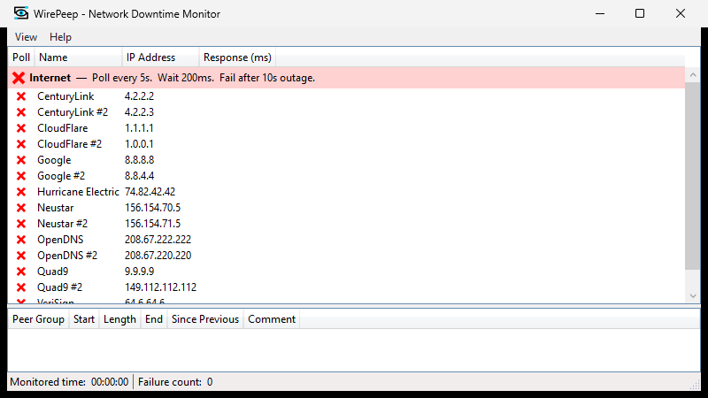
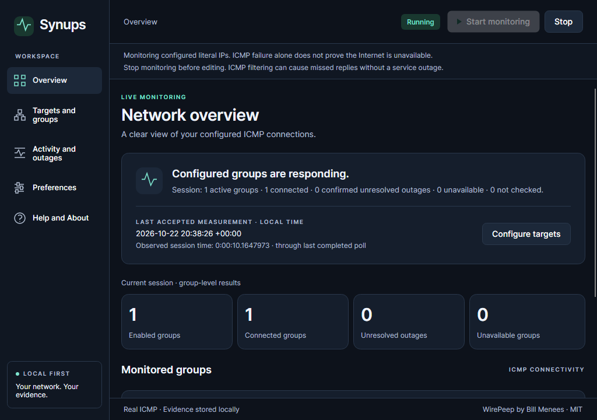

# Synups — judge’s guide

**Know when your network drops. Know how long it lasts. Keep the evidence.** Synups is a local-first network reliability monitor migrated from [Bill Menees’ WirePeep](https://github.com/menees/WirePeep), preserving its MIT licence and peer-group monitoring intent while moving from Windows WPF to Avalonia desktop.

**Evaluate the public [v0.1.1 release](https://github.com/samscript18/Synups/releases/tag/v0.1.1).** It contains unchanged internal **0.1.1-rc.4**, application `6c812fde9a29eeb8cfd6399a2f1a75e333e81e03`. No account, backend or .NET SDK is required. [Windows x64 ZIP](https://github.com/samscript18/Synups/releases/download/v0.1.1/Synups-win-x64.zip) · [macOS arm64 tar.gz](https://github.com/samscript18/Synups/releases/download/v0.1.1/Synups-osx-arm64.tar.gz) · [Linux x64 tar.gz](https://github.com/samscript18/Synups/releases/download/v0.1.1/Synups-linux-x64.tar.gz) · [SHA256SUMS](https://github.com/samscript18/Synups/releases/download/v0.1.1/SHA256SUMS).

## Migration at a Glance

| Question | Review evidence |
|---|---|
| What was preserved? | Literal-IP peers/groups, stable IDs, timings, sorted rotation, first success, failure grace, comments and logging/export intent |
| What changed? | Avalonia composition, bounded async execution, monotonic durations, explicit indeterminate states, durable SQLite and safe original-settings import |
| How complete? | **(15 complete + 3 partial × 0.5) / 18 = 91.7%**; alerts, preferences and placement/tray retain documented gaps |
| A2 — migration audit | [18 source-backed rows, exact changes, difficulty and limits](../migration/FEATURE_PARITY.md) |
| A5 — architecture | [Published/alpha snapshots, five diagrams, lifecycle, storage and decision trade-offs](../migration/ARCHITECTURE.md) |
| C2 — security/privacy | [Trust model, actual traffic, local data, integrity and distribution limits](../../SECURITY.md) |
| Verification | [Exact public-source native CI](https://github.com/samscript18/Synups/actions/runs/39850198899), [platform matrix](../migration/CROSS_PLATFORM.md), [frozen public asset receipt](../evidence/verification/synups-0.1.1-publication.json) |

## Five-minute evaluation

1. Verify the download checksum, extract the **complete** archive and follow [installation guidance](../release/INSTALLATION.md). Windows is unsigned; macOS is ad-hoc/non-notarized and retained Gatekeeper assessment rejects trusted distribution; Linux needs the documented graphical/native libraries. Do not bypass OS security.
2. Launch `Synups.exe`, `Synups.app` or `./Synups`. Enter a group, target name and **literal IP you are authorized to monitor**, then choose **Add target and create group**. Opening the app sends no probes unless a launch preference was deliberately enabled.
3. Choose **Start monitoring**. Inspect group state, measured RTT and last-check/freshness labels. Alternative peers rotate and stop at first success; other peer rows can be stale/not checked.
4. Review **Activity and outages**. If an actual incident exists, add a comment and export CSV. An empty history is legitimate; unknown recovery is not fabricated. Stop before changing configuration, restart and verify saved history/settings.
5. Review the [genuine isolated incident sequence](INCIDENT_DEMO.md) for controlled ICMP loss, grace, confirmation, recovery and CSV. It retains its **rc.3** source qualification and is not relabelled as a fresh rc.4 outage or an ISP failure.

## Genuine before and after

| WirePeep — original WPF / Windows | Synups — actual rc.4 / Windows |
|---|---|
|  |  |

Original source is upstream `61ae14391151ca9f209223e62c98fae3df5482b8`. Its genuine Windows capture used application-scoped outbound blocking on a disposable runner; failed rows are controlled test results. After images are actual extracted rc.4 client-tree captures with real loopback, not physical input certification. [macOS](../evidence/after/2026-10-22-desktop-completion/osx-arm64/exercise-overview.png) · [Linux](../evidence/after/2026-10-22-desktop-completion/linux-x64/exercise-overview.png) · [source/hash/capture provenance](../evidence/README.md). No screenshot is a reconstructed mockup.

## What made the port substantial

The WPF window originally coordinated synchronous monitoring, row collections, logging, alerts and exit. The port separates Core state and execution from Avalonia presentation, owns cancellation through shutdown and preserves ordered peer selection/failure grace. Unavailable probes no longer invent recovery; UTC evidence is distinct from monotonic elapsed time. SQLite adds durable incidents/comments, bounded pages, interruption recovery, backup and explicit failed-write handling to the original session-memory log. A real Menees 5.1.2 fixture emitted by untouched upstream, rather than a guessed file format, supports profile-only preview/import/backup with original GUIDs/timings.

[The technical difficulty table](../migration/FEATURE_PARITY.md#why-this-migration-was-technically-difficult) ties each original problem to source, solution and verified outcome. [Architecture decisions](../migration/ARCHITECTURE.md#architecture-decisions-and-operational-trade-offs) explain trade-offs. [The migration log](../migration/MIGRATION_LOG.md) preserves failures, fixes and historical checkpoints. Work was AI-assisted, dated 16–22 October 2026 for the frozen release; no labor-hour or unmeasured performance total is claimed.

## Published verification and remaining limits

| Actual public-release environment | Default .NET tests | Separate real/native | Audio request/fallback | Extracted apphost |
|---|---:|---:|---:|---|
| Windows Server 2025 x64 | 159 passed; 5 intentional skips | 3 passed | 1 passed | Six stages passed |
| macOS 15 arm64 | 159 passed; 5 intentional skips | 3 passed | 1 passed | Six stages passed |
| Ubuntu 24.04 x64 / Xvfb + Openbox | 160 passed; 4 intentional skips | 3 passed | 1 passed | Six stages passed |

There are **164 unique .NET cases** across invocations/platforms, not 164 default passes on every OS. Each passed eight Python safety tests, locked restore/dependency audit and zero-warning Release. Extracted apphost checks cover native windows/restoration, clipboard, genuine import/backup, real loopback, preferences and SQLite restart/interruption/read-only repair. Five normal stages exit zero; deliberate process termination is separately expected. The downloaded Mac apphost also passed its local six-stage check. [Retained reports](../evidence/verification/2026-10-22-desktop-completion.json). Exact-source [CodeQL](https://github.com/samscript18/Synups/actions/runs/39851153694) retained zero SARIF results; scoped coverage was 79.83% lines / 66.89% branches, not a complete security proof.

**Still partial:** notification delivery/audibility/attention, actual next-login launch/removal, physical tray and native multi-display behavior. Physical keyboard/native Save-panel/accessibility checks, wider IPv6/VPN/suspend/Wayland/endurance and trusted signing also remain limited. macOS Accessibility/event-post permission was denied. Windows native delivery failed independent observation and its adapter was withdrawn; accessible in-app alerts remain. Programmatic real-control invocation is not physical acceptance. [Detailed acceptance limits](../release/DESKTOP_COMPLETION_CANDIDATE.md) · [Mac physical checklist](../release/MACOS_ACCEPTANCE.md) · [distribution trust](../release/DISTRIBUTION_TRUST.md).

## Separate development work — not in these downloads

Network diagnostics and incident investigation capabilities are under development separately in **v0.2.0-alpha.1**. **These features are not included in the v0.1.1 downloads.** Its frozen application is `3c4462a71cbb90032603cd3eaf4366c2561474d7`; [branch](https://github.com/samscript18/Synups/tree/feat/network-diagnostics), [hardening report](https://github.com/samscript18/Synups/blob/feat/network-diagnostics/docs/diagnostics/HARDENING_REPORT.md) and [31-feature matrix](https://github.com/samscript18/Synups/blob/feat/network-diagnostics/docs/diagnostics/FEATURE_MATRIX.md) have separate tests, screenshots, hashes and limits. They add no points to the 18-item legacy score. Uncommitted expansion work is paused, not released or accepted.

The [public release description](https://github.com/samscript18/Synups/releases/tag/v0.1.1) is current; frozen archive handoff text retains its historical build-time wording. No asset is rebuilt or relabelled. [MIT attribution](../../LICENSE) remains intact. Best IT Pro Tool is the intended category, not a claimed award. The [prepared submission material](../release/SUBMISSION.md) is guidance only: **no competition form or acceptance is claimed**. Public v0.1.0 and prior candidates remain unchanged rollback baselines.
