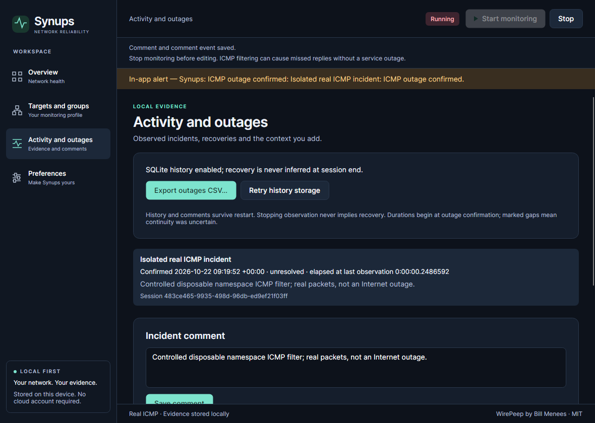
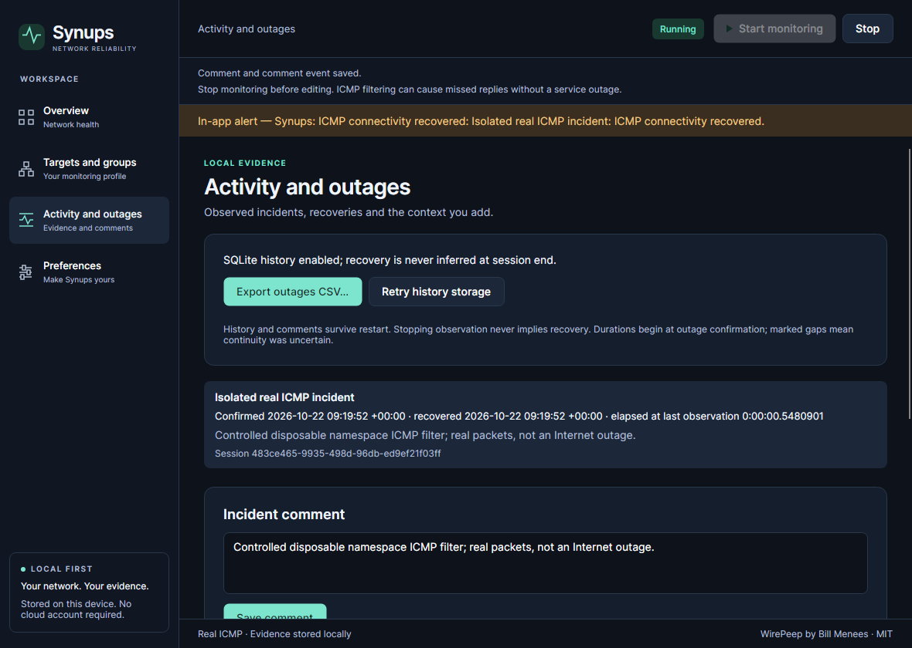

# Controlled real ICMP incident protocol

This is a reproducible engineering demonstration, **not simulated measurements and not an Internet outage**. Actual production IcmpProbe and MonitoringService run against 127.0.0.1 inside a disposable Linux network namespace. A namespace-local kernel firewall rule drops actual incoming echo replies after successful connectivity, then is removed after confirmed outage. The user’s host firewall, routes, interfaces and network configuration are never changed.

**Passed on Ubuntu/Xvfb**, source `535b91f18e2d98714d703364b9e3e3631cdad992`, [run 39754244507 / Linux job](https://github.com/samscript18/Synups/actions/runs/39754244507/job/119742116397). Downloaded artifacts were independently inspected: namespace file hashes, SQLite `quick_check`, CSV and second-process incident/event identity all pass. The user’s Mac/network was not modified.

| Actual UTC observation | Recorded value |
|---|---|
| Session started / real healthy state observed before filtering | 2026-10-22 09:19:49.1430781Z |
| First failed observation | 09:19:49.8702205Z |
| Failure-grace UI capture observation | 09:19:49.8853444Z; no confirmed incident yet |
| Outage confirmed | 09:19:52.1138880Z; 2.244s after first failure, configured grace 2s |
| Recovery observed after removing isolated filter | 09:19:52.6619422Z |
| Confirmed-incident monotonic duration | 0.5480901s; CSV rounded to 0.548s |
| Clean stop / process reload | Same incident ID, comment and five events; exactly one outage and one recovery |

Durations begin at confirmation, preserving WirePeep intent; the grace is not counted as confirmed outage duration. Session-start time is not claimed as the exact first successful packet timestamp. The short controlled disruption is evidence of transitions, not a representative service outage or long-duration endurance.

[Raw incident](../evidence/verification/2026-10-22-real-incident/incident.json), [separate-process reload](../evidence/verification/2026-10-22-real-incident/restart.json), [namespace actions and hashes](../evidence/verification/2026-10-22-real-incident/namespace-evidence.json), [actual CSV](../evidence/verification/2026-10-22-real-incident/real-incident.csv), [retained CI logs](../evidence/verification/2026-10-22-competitive-ci-logs.zip).

| Actual unresolved incident / in-app outage alert | Actual recovery / in-app recovery alert |
|---|---|
|  |  |

[Healthy](../evidence/after/2026-10-22-competitive/linux-incident/healthy.png), [grace](../evidence/after/2026-10-22-competitive/linux-incident/failure-grace.png), [restarted history](../evidence/after/2026-10-22-competitive/linux-incident/restart-history.png). These are genuine native client-tree renders from the source-component verifier. They are not physical desktop input, OS notification delivery or packaged-apphost incident tests.

## Guardrails

The worker requires Linux/root, a network namespace different from PID 1, only the loopback interface and no default route. It refuses host/mixed-interface namespaces before any mutation. Four deterministic safety tests exercise these refusals. It permits only its own new output directory, explicit loopback configuration and finite observation deadlines. It never scans or probes external addresses. The one filter has a unique comment and exact add/remove arguments; finally removes it and terminates only the owned child. Namespace teardown removes its networking state.

No privileged worker belongs in the shipped application. `eng/incident-smoke.cs` is compiled as a separate source-component native verifier, not included in production projects. Programmatic UI actions/captures are distinct from physical interaction and actual published-apphost checks.

## Runner reproduction

Use a disposable Ubuntu 24.04 runner/VM with .NET 10, Python 3, Xvfb, iproute2, iptables and Avalonia native display dependencies. Build before isolating networking:

```sh
python3 eng/incident-smoke.py --prepare artifacts/incident-build
xvfb-run -a -s '-screen 0 1440x1000x24' bash -c 'sudo env "PATH=$PATH" "DOTNET_ROOT=$DOTNET_ROOT" "DISPLAY=$DISPLAY" "XAUTHORITY=$XAUTHORITY" "GITHUB_SHA=$GITHUB_SHA" unshare --net -- python3 eng/incident-smoke.py --worker artifacts/incident-build/bin/Release/net10.0/Synups.IncidentSmoke.dll --output artifacts/incident'
```

Do **not** remove namespace guards or run firewall commands in the host namespace. Local macOS lacks this Linux namespace facility; Docker is installed but its daemon is absent, so no local isolated incident pass is claimed. This does not authorize altering the user’s actual network.

## Required observations and exported evidence

- Real success and healthy visible UI before the controller installs a filter.
- Actual Disconnected observations before confirmation, with no incident during initial grace.
- Confirmation after configured 2s continuous failures, one stable incident ID, UTC first-failure/start and monotonic duration.
- Visible in-app unresolved incident/comment, then real success after filter removal and exactly one recovery.
- Quoted CSV with genuine incident, timestamps and context explaining the controlled environment.
- Clean Stop/Close; a separate process reloads the same incident/comment/events without generating another recovery or automatically starting.
- Native client PNGs for healthy, grace, confirmed outage, recovery and restarted history; JSON transition data, namespace/actions/hashes, CSV and console logs retained by CI even on failure.

These are observed loopback ICMP failures/recovery caused by a documented isolated filter, not a real Internet/provider outage or a physical cable/power-loss experiment. A Linux success must not be relabelled as a macOS/Windows incident run. The linked exact-source run passed; other platforms are not assigned that incident result.


First exact-source run7fe86f7 exposed a useful distinction: a namespace-local OUTPUT/drop of requests returned EACCES, correctly classified PermissionDenied/Unavailable, with no invented outage. The controller was corrected to filter incoming echo replies; real requests can then send successfully and expire without replies. Probe/engine semantics were not changed and assertions remain strict. Windows guard tests also needed create=True when mocking the Unix-only geteuid symbol; the Linux host-namespace guard itself was not relaxed. Failed run/logs are preserved and not counted as a demonstration pass.


## Repeated at the final candidate revision

Final source `65d917ac645139836cf97e48c48c137a09825942`, [successful run 39761184906](https://github.com/samscript18/Synups/actions/runs/39761184906), independently repeated the controlled real incident. First failure 10:13:54.9720378Z, confirmation 10:13:57.2113907Z, observed recovery 10:13:57.7604230Z; confirmed monotonic duration **0.5490790s**. Exactly one outage/recovery and the same ID/comment/events reloaded in a second process. [Final raw incident](../evidence/verification/2026-10-22-real-incident-final/incident.json), [reload](../evidence/verification/2026-10-22-real-incident-final/restart.json), [namespace/hash record](../evidence/verification/2026-10-22-real-incident-final/namespace-evidence.json), [CSV](../evidence/verification/2026-10-22-real-incident-final/real-incident.csv). Every namespace-listed file hash, SQLite quick_check and CSV identity passed independent inspection. The images above intentionally retain their first successful source 535b91f provenance rather than being relabelled as the later run.


## Final hardening timeline and focus verification

Source **6446990571c285b5c2e2a4bb293cbd8e3af40171**, [Linux job119838092898](https://github.com/samscript18/Synups/actions/runs/39782799326/job/119838092898), repeated the isolated real ICMP demonstration with the new timeline and desktop actions. First failure **2026-10-22T13:01:08.2108246Z**; grace observed13:01:08.2319188Z with no confirmed incident; confirmation13:01:10.4520179Z after2.2411933s; real recovery13:01:10.9992237Z after removing the namespace filter. Confirmed monotonic duration **0.5472800s**. Exact incident ID `7cdbd394-7c5a-4cce-b9d0-5775055765d5`, comment and all five events match after separate-process restart. SQLite quick_check, CSV identity and all 17 namespace-listed file hash pass independent review.

The verifier hid the actual native window before confirmation, then observed it restored by the explicitly enabled event-focus preference. Exactly two focus requests were recorded (outage/recovery). The real native clipboard was read back and matched incident ID/UTC details. These are programmatic native actions, not physical tray/keyboard interactions or proof of universal OS foreground permission. The native timeline showed confirmed then recovered states with stable rows and comments; ordinary stop added no false recovery.

[Raw incident](../evidence/verification/2026-10-22-hardening-incident/incident.json), [separate-process reload](../evidence/verification/2026-10-22-hardening-incident/restart.json), [namespace/actions/hash record](../evidence/verification/2026-10-22-hardening-incident/namespace-evidence.json), [unchanged real CSV bytes](../evidence/verification/2026-10-22-hardening-incident/real-incident.csv). Genuine same-source images: [healthy](../evidence/after/2026-10-22-hardening/linux-incident/healthy.png), [grace](../evidence/after/2026-10-22-hardening/linux-incident/failure-grace.png), [confirmed](../evidence/after/2026-10-22-hardening/linux-incident/confirmed-outage.png), [recovered](../evidence/after/2026-10-22-hardening/linux-incident/recovered-history.png), [reloaded](../evidence/after/2026-10-22-hardening/linux-incident/restart-history.png). Source-component/native client-tree captures remain distinct from the separately passed six-stage real packaged-apphost suites. No host network was modified and no provider outage, fake probe or injected measurement is represented.
