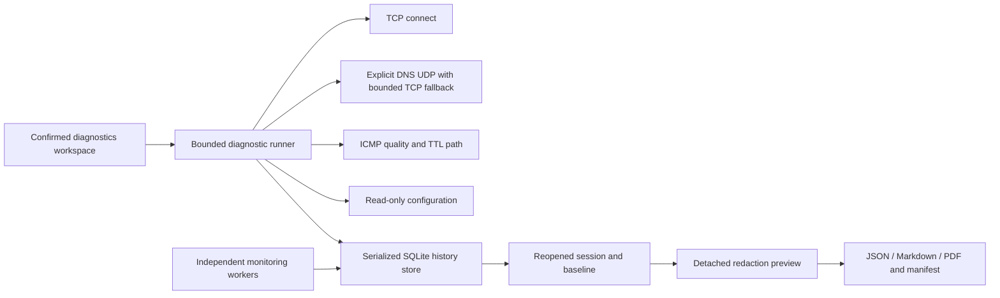

# Diagnostics candidate architecture

This describes frozen alpha **3c4462a71cbb90032603cd3eaf4366c2561474d7 / 0.2.0-alpha.1**, separate from published v0.1.1 at **6c812fde9a29eeb8cfd6399a2f1a75e333e81e03 / 0.1.1-rc.4**. Paused uncommitted adapter experiments are outside this snapshot. See [the two architecture snapshots and engineering decisions](../migration/ARCHITECTURE.md). Feature and platform acceptance belongs in [FEATURE_MATRIX.md](FEATURE_MATRIX.md); earlier release evidence does not validate changed candidate code. The existing monitoring architecture is documented in [the migration architecture](../migration/ARCHITECTURE.md).

## Boundaries and data flow

The Avalonia diagnostics workspace prepares an exact target, selected tests, limits, profile version and consent snapshot. Its confirmation precedes execution. A diagnostic does not start monitoring, manufacture an incident, or change incident failure/recovery state. Selecting an existing incident carries its durable ID into a diagnostic request; the user still supplies and approves the endpoint.

`DiagnosticRequest.ValidatedCopy` validates finite limits and snapshots the selected tests. `DiagnosticRunner` owns diagnostic tasks separately from monitoring workers. Its default concurrency is two sessions, configurable from one to four, with one running session per canonical target and immediate rejection when capacity is occupied. There is no unbounded pending diagnostic queue. Each session has a linked cancellation/deadline token; adapters also apply their probe limits. Progress is presentation data, not evidence of a measurement.

## Real providers and limits

| Adapter | Actual mechanism | Explicit limit |
|---|---|---|
| TCP | System hostname resolution when needed, then one `Socket.ConnectAsync` to one selected resolved address and approved port | No application request, port scan, raw SYN or automatic address sweep |
| DNS | Explicit A/AAAA question over UDP to an approved explicit resolver or the first resolver reported on an active interface | One bounded same-endpoint TCP retry after validated truncation if probe cap permits; no DNSSEC validation, DoH or split-DNS policy inference |
| Ping quality | OS ICMP echo with empty payload, bounded samples, intervals and deadlines | ICMP nonresponse is not proof of application loss; missing RTTs remain absent |
| Traceroute | Real ICMP echo with increasing TTL/hop limit, bounded hops and samples | Control-plane replies do not prove the forwarding path, location or fault cause |
| Configuration | .NET interface/address/gateway/DNS enumeration and existing bounded native default-route discovery | Default routes only; no configuration changes, complete route-table claim, proxy or search-domain capture |
| Optional hop names | Direct PTR wire queries, off by default, with bounded per-trace session cache, timeout, task cap and cancellation | One representative address per observed hop, at most 64 distinct candidates; failed names keep literal addresses; PTR is not identity proof |

Raw TCP SYN and UDP probing have distinct kinds but return Unsupported without sending substitute TCP traffic. Capture, ASN/ownership enrichment, remote corroboration, diagnostic scheduling and new diagnostic threshold alerts are not implemented. No new package dependency was introduced for these diagnostics: sockets, ICMP, DNS parsing, PDF generation and hashing use the existing runtime; persistence and UI reuse the existing SQLite and Avalonia dependencies.

## Persistence and ownership

`SqliteHistoryStore` retains its process lease, serialized background I/O, configured page limit and existing backup controls. Schema version 2 adds diagnostic sessions, results, observations, baselines and comparisons with indexes and foreign keys. An upgrade of existing v1 history creates a separate SQLite backup, verifies it with `quick_check`, and publishes that backup before the schema transaction. Failure to make the backup stops migration. The original file is not reset to recover from corruption or an unknown schema.

A session checkpoint is saved before network work, and after each adapter returns, before the next adapter begins. No transaction spans a network operation. These are between-test checkpoints: a process crash during a multi-probe adapter can lose that adapter's current unsaved samples. On initialization, persisted Pending/Running checkpoints become Interrupted while retaining original timestamps and saved results; recovery does not invent a completion time or monitoring recovery.

Completed evidence is retained as a typed, versioned session snapshot, with normalized result and observation rows. Successful saved sessions can be labeled as baselines. Comparisons must preserve differences in test definitions, windows, parameters and missing measurements rather than invent equivalent deltas.

Existing opt-in monitoring retention remains. A diagnostic foreign key pins its linked incident and prevents retention of that incident's monitoring session. Confirmed diagnostic deletion is transactional: baseline deletion removes associated comparisons while preserving sessions; referenced or active sessions cannot be deleted. Existing opt-in retention removes only old terminal standalone diagnostics with known completion times and no references. All share the history capacity. Reaching capacity surfaces a write error; it does not authorize automatic evidence deletion.

## Evidence rendering

Preview detaches evidence and applies redactions before rendering. JSON, Markdown and PDF receive the same preview document. JSON member names are sorted ordinally with compact UTF-8 output and retained array order. This is Synups's specified custom canonicalization, not a claim of RFC 8785 compliance. The portable PDF renderer uses a built-in font and represents non-ASCII characters as visible Unicode escapes; it does not depend on installed fonts.

Export writes into a unique sibling staging directory, hashes the actual bytes of each artifact with SHA-256, writes a manifest, then renames the completed directory. Individual artifacts are capped at 16 MB. The checksum establishes byte integrity relative to the manifest, not authenticated origin. See [privacy](PRIVACY.md) and [stability](STABILITY.md) for disclosure and failure handling.

System hostname lookups for TCP/ICMP are bounded by BoundedHostnameResolver (two native workers, no waiting queue). Caller cancellation can return promptly while the original OS lookup still owns its slot. Further lookups fail explicitly when those slots are occupied; literal IP requests avoid DNS. Shutdown also drains retained native tasks within the remaining seven-second target; a hung OS resolver keeps ownership and requires retry, rather than abandoning work. Direct DNS/PTR use owned cancellable UDP sockets.
