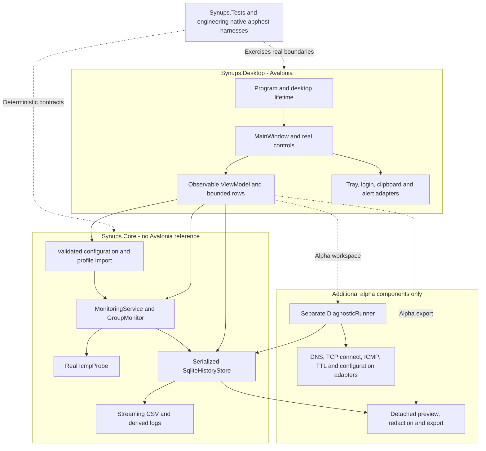
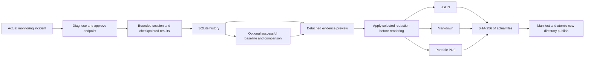
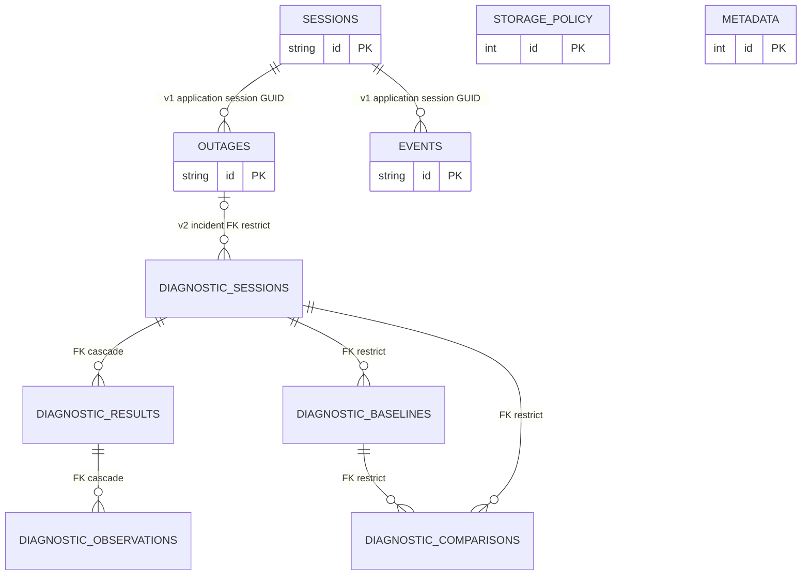
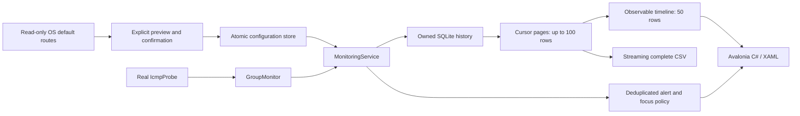

# Architecture — published release and diagnostics alpha

[Reproducible migration size, Git range and exclusions](MIGRATION_MEASUREMENTS.md) · [Selected screenshots and exact provenance](../competition/SCREENSHOTS.md). Measurements apply only to frozen public v0.1.1 / internal rc.4.

This document separates two implemented snapshots. **A: public v0.1.1**, application `6c812fde9a29eeb8cfd6399a2f1a75e333e81e03`, internal `0.1.1-rc.4`. **B: separate v0.2.0-alpha.1**, application `3c4462a71cbb90032603cd3eaf4366c2561474d7`. Alpha code and test counts are not evidence for released v0.1.1 bytes. Paused, uncommitted expansion work is not part of either snapshot. Earlier phase notes remain below as history.

[Published source tree](https://github.com/samscript18/Synups/tree/6c812fde9a29eeb8cfd6399a2f1a75e333e81e03/synups) · [alpha source tree](https://github.com/samscript18/Synups/tree/3c4462a71cbb90032603cd3eaf4366c2561474d7/synups) · [source-backed parity audit](FEATURE_PARITY.md) · [exact release execution evidence](../evidence/verification/2026-10-22-desktop-completion.json) · [alpha hardening evidence](../diagnostics/HARDENING_REPORT.md).

## Overall architecture

The original WPF solution under `src/` remains separate. `Synups.slnx` includes Core, Desktop and Tests; no second backend, cloud host, WebView or DI container was introduced. Explicit construction keeps ownership visible. The original MIT default XML is linked as an embedded Core resource without running the original constructor's discovery side effects.

## A. Published v0.1.1

### Monitoring execution and evidence

[MonitoringService](https://github.com/samscript18/Synups/blob/6c812fde9a29eeb8cfd6399a2f1a75e333e81e03/synups/Synups.Core/Monitoring/MonitoringService.cs) serializes lifecycle changes. Start validates and freezes the profile, initializes/retries history, commits a new session, then owns independent group loops. A semaphore bounds active group polls to four by default; one group never overlaps itself. [GroupMonitor](https://github.com/samscript18/Synups/blob/6c812fde9a29eeb8cfd6399a2f1a75e333e81e03/synups/Synups.Core/Monitoring/GroupMonitor.cs) rotates name-sorted targets, retains the original 20 ms eligibility tolerance and stops after the first success. Unvisited peers are stale/not checked, not newly measured healthy peers.

```mermaid
stateDiagram-v2
    [*] --> Stopped
    Stopped --> Running: Explicit Start or saved launch opt-in
    Running --> Running: Eligible group poll and durable batch
    Running --> Stopping: Stop or close cancels owned work
    Running --> Faulted: Durable write or session error
    Stopping --> Stopping: Native call exceeds bounded wait; retry required
    Stopping --> Stopped: Workers drain and evidence saves
    Faulted --> Stopped: Stop and successful evidence retry
    Stopped --> Running: New session after valid configuration
```

Inside a poll, sustained disconnected observations must reach the configured grace before one incident starts. Confirmation time is the incident start; first missed observation is retained separately. Measured success records recovery. An unavailable probe resets an unconfirmed streak but cannot recover a confirmed incident. Large scheduling gaps mark uncertainty. UTC is evidence; `Stopwatch`/`IMonitorClock` governs elapsed intervals. Stop ends observation without inventing recovery. [Original behavior and deliberate corrections](LEGACY_SEMANTICS.md) are backed by linked-original characterization and migrated-engine tests.

[SqliteHistoryStore](https://github.com/samscript18/Synups/blob/6c812fde9a29eeb8cfd6399a2f1a75e333e81e03/synups/Synups.Core/Persistence/HistoryStore.cs) owns one connection, one process file lease and a serialized off-thread I/O semaphore. Connection pooling is off, busy timeout is two seconds, journal mode is DELETE and `synchronous=FULL`. The file is `history.v1.db` with schema version 1 for this snapshot. A transaction commits changed outages, sequenced events and session observation metadata together; retries reuse stable identities. A failed write remains pending in owned memory, cancels monitoring and prevents a misleading clean-save claim. Corruption, unsupported versions and denied access preserve the file rather than resetting it.

At restart an unended monitoring session becomes Interrupted; an unresolved incident keeps its last observation end and stored elapsed duration. No duration is extended through a process gap, and a new Start creates a new session. Capacity is a durable SQLite policy (default 1 GiB, UI range 256 MiB–10 GiB), not an unlimited log promise. Opt-in retention protects unresolved/interrupted evidence; freed pages are reused, not securely erased. A full SQLite backup is distinct from CSV export. See historical storage rationale below and [storage tests](https://github.com/samscript18/Synups/blob/6c812fde9a29eeb8cfd6399a2f1a75e333e81e03/synups/Synups.Tests/StoragePolicyTests.cs).

### Presentation, settings and platform boundaries

The window's 250 ms dispatcher timer reads snapshots while monitoring runs; it does not schedule probes. Stable observable rows receive bounded updates. Incident history uses asynchronous bounded paging; CSV streams persisted rows. Draft changes save before replacing active configuration, and editing requires stopped monitoring so an old sample cannot attach to a changed address.

`ConfigurationStore` and `PreferencesStore` use versioned JSON, validation and same-directory atomic replacement. Unreadable files are preserved and need explicit recovery/backup. The profile-only `LegacySettingsReader` uses bounded XML with DTD/external resolution disabled, a genuine Menees 5.1.2 fixture and explicit import preview/confirmation. Group/target GUIDs and supported timings survive; WirePeep settings, history and OS startup preferences are not overwritten by import. Windows-specific options are not blindly imported.

OS-specific adapters contain native commands/APIs: gateway queries are read-only and bounded; startup registration is explicit and reversible; tray hiding is conservative when restoration is unestablished; clipboard and native storage pickers remain desktop concerns. In-app alerts work independently of optional native delivery. Windows native notifications were withdrawn after failed visible delivery; sound-process success does not establish audibility. Closing awaits pending UI work and drains monitor/storage ownership. A worker exceeding the seven-second target remains owned and restart/close is blocked for retry, not abandoned.

## B. Separate diagnostics alpha

[DiagnosticRunner](https://github.com/samscript18/Synups/blob/3c4462a71cbb90032603cd3eaf4366c2561474d7/synups/Synups.Core/Diagnostics/DiagnosticRunner.cs) owns a separate budget: two sessions by default, one per canonical endpoint, immediate rejection when full and no unbounded queue. `ValidatedCopy` checks target approval, tests, finite limits, resolver consent and probe cap before execution. The UI snapshots the exact request before confirmation. Each adapter runs serially within its session under linked cancellation/deadlines; diagnostic tasks never change monitoring targets, scheduler or incident recovery.

```mermaid
stateDiagram-v2
    [*] --> Draft
    Draft --> Confirmed: Exact target, methods, limits and consent reviewed
    Confirmed --> Running: Capacity acquired; initial checkpoint saved
    Running --> Running: Adapter returns; immutable result checkpoint saved
    Running --> Completed: Every selected test succeeds
    Running --> Partial: Deadline, missing tests or mixed outcomes
    Running --> Failed: No successful result
    Running --> Cancelled: Caller or shutdown cancellation
    Running --> Interrupted: Process ends; next startup recovers saved checkpoint
    Completed --> Reopened: Read history; no probes
    Partial --> Reopened
    Failed --> Reopened
    Cancelled --> Reopened
    Interrupted --> Reopened
```

Adapters record typed results, UTC observations, method/provenance and monotonic durations: real one-port TCP connect (first resolved address only), explicit A/AAAA DNS with bounded same-resolver UDP-to-TCP truncation fallback, ICMP quality, TTL/hop-limit path and read-only interfaces/default routes. Optional PTR is off by default, session-cached and bounded; failed names leave literal addresses. Two retained system-hostname workers prevent cancellation from spawning unlimited native resolver tasks. [Provider details and limits](../diagnostics/ARCHITECTURE.md) include exact bounds and unsupported behavior.

Schema 2 is additive and uses the same serialized store owner. Before upgrading schema 1, a SQLite backup is created and checked, then the schema transaction runs. A checkpoint precedes network work and follows each returned test; no SQL transaction spans network I/O. A crash can lose the current test's unsaved samples. Restart marks saved Pending/Running work Interrupted without assigning a fabricated completion time. Terminal results are immutable; baselines reference fully successful sessions; comparisons require compatible definitions and leave missing data Unknown. Links are chosen at request creation, not retroactively attached to another incident.

The export is local/offline. JSON uses ordinal sorted-member serialization with array order preserved, not a claim of RFC 8785 compliance. JSON/Markdown retain Unicode; PDF shows explicit non-ASCII escapes. Each artifact is capped at 16 MB; cancellation/failure cleans normal staging, while process termination can leave an incomplete staging folder. SHA-256 detects changed bytes relative to the manifest, not origin/authorship. Redaction precedes all renderers; timestamps, IDs, units and metrics can still identify activity. [Privacy](../diagnostics/PRIVACY.md), [migration/rollback](../diagnostics/SQLITE_MIGRATION.md) and [hardening](../diagnostics/HARDENING_REPORT.md) record the boundaries.

### SQLite entities and enforced relationships

`SESSIONS`, `OUTAGES`, `EVENTS`, `METADATA` and `STORAGE_POLICY` exist in published schema 1. Their drawn session GUID relationships are application-managed, not newly invented SQL foreign keys. Only `DIAGNOSTIC_*` tables/relationships are alpha schema 2 additions; observations use `(result_id, ordinal)` as a composite primary key. Alpha enables foreign keys. An incident-linked diagnostic pins its original monitoring session against retention. Baselines/comparisons pin source sessions; deleting a confirmed baseline removes its comparisons transactionally and preserves those sessions. Confirmed terminal-session deletion cascades results/observations and rejects active or referenced work. Opt-in retention deletes only eligible old terminal standalone diagnostics. The baseline selector currently shows the latest 100; session history pages safely through equal timestamps.

## Architecture decisions and operational trade-offs

These are design alternatives recorded in source/history, not claims of experimental prototypes that never existed.

| Decision | Alternatives considered | Rationale | Trade-off | Operational implication | Verification |
|---|---|---|---|---|---|
| Keep original source separate; port domain intent into UI-free Core | Reuse Windows-targeted Common unchanged or only translate WPF XAML | Legacy Common inherits Windows targets/settings/discovery; the window also owns orchestration | More explicit domain/presentation code | Original ancestry/resources stay reviewable; Core has no Avalonia dependency | Source inventory and five linked-original characterization tests |
| Explicit three-project composition | Add a generic host/DI container or Infrastructure project immediately | Ownership is small and visible; original tests accept injected boundaries | Composition must be maintained deliberately | Lifetime/disposal paths are directly inspectable | Constructor/lifecycle tests and native close/restart |
| Single serialized SQLite connection with DELETE/FULL | Rewrite a JSON snapshot; custom append journal; WAL with extra ownership/checkpoints | Atomic multi-record batches and crash rollback; one writer does not need a second concurrency model | Native SQLite packaging; busy/full errors still require handling | Off-dispatcher serialization; lease, bounded busy timeout and retained pending writes | Actual full/busy/corrupt/readonly/interruption tests, separately scoped to each source |
| Monotonic elapsed time plus UTC evidence | Preserve UTC-only interval calculations | Clock changes and sleep must not invent continuous failure/recovery | Gaps and durations require explicit modelling | UTC sequence/timestamps remain evidence; observation gaps stay visible | Clock-jump/grace/gap tests |
| Separate bounded diagnostic ownership | Reuse continuous monitoring's scheduler and outcomes | Diagnostic sampling and slow DNS/path work must not alter peer-selection or recovery semantics | Independent caps, cancellation and shutdown coordination | Two diagnostic sessions do not consume the monitoring semaphore or hold SQL locks over network I/O | Alpha real concurrent monitoring/diagnostics and worker/persistence checks |
| Genuine profile-only import with confirmation | Guess historical Menees formats or import all Windows settings | Compatibility needs an actual fixture and bounded supported schema | Some historical variants intentionally refused | Original source untouched; destination backup before replacement; no automatic probing | All three rc.4 packaged import/backup/reload actions |
| Untrimmed self-contained candidate, explicit unsupported trust | Trim/AOT immediately; assume a successful compile means runnable/trusted | Reflection/JSON/Avalonia resources/native assets need acceptance; signing needs credentials | Larger archives; signing and extra architectures remain limited | Preserve dependency licences and native assets; no security bypass or fabricated notarization | Per-file manifests, exact hashes, three native extracted apphosts; extra alpha RIDs build-only |

## Native and release boundaries

Published v0.1.1 evidence is Windows Server 2025 x64, macOS 15 arm64, Ubuntu 24.04 x64/X11/Xvfb/Openbox, plus the separately recorded local Mac run. The alpha additionally builds Linux-arm64 and macOS-x64 but does not execute them on matching hardware. Native IPv6 and physical-network topology, all Wayland/VPN/suspend cases, physical tray/picker/keyboard/notification/login delivery and real multi-display restoration are not universally certified.

Both snapshots use untrimmed, non-AOT self-contained packaging. Runtime JSON/reflection and Avalonia/native SQLite/graphics resources are explicit trimming/AOT review surfaces, not proven incompatibilities or successful AOT support. Windows is unsigned; macOS has ad-hoc bundle integrity without Developer ID/notarization. Respect OS policy; do not disable security controls. Raw SYN/UDP diagnostic probes, capture, ASN enrichment, remote probes, scheduled diagnostics and new threshold/chart integrations remain unavailable in the frozen alpha. Uncommitted adapter experiments are not a verified release capability.

## Historical phase architecture notes

The following retained notes describe their original phase, not the current public release. Statements such as “planned”, “not implemented” or “Phase 3 current” apply only to those earlier checkpoints. Use snapshots A/B above for present claims.

The entries below are preserved historical checkpoints; current release snapshots are documented above.

## Phase 1 decision

Decision date: 2026-10-16. Audit precedes implementation. Original source and solution remain intact.

## Existing boundaries
`WirePeep.sln` contains `WirePeep` and `WirePeep.Common`. Common has no WPF reference, but inherits net48/net6.0-windows, signing, analyzers and resources from src/Directory.Build.props. Its domain objects mix Menees settings serialization with state; Profile construction can synchronously discover devices. StateManager owns observable collections and synchronous parallel ping updates without cancellation. WPF MainWindow owns scheduling, history, logging, alerts and settings, so replacing XAML alone cannot preserve the application.

## Chosen foundation
New code lives under `synups/`, outside legacy build props. `Synups.slnx` selects only the new projects and avoids the legacy PowerShell script's *.sln discovery. Target .NET 10 LTS; pin verified stable Avalonia packages. Use official Avalonia application template, standard desktop lifetime, native window chrome and Fluent controls.

- Synups.Core: small UI-free typed default-profile reader and models. Reuse the original DefaultProfile.xml as a linked embedded resource, with provenance. Read literal targets without running discovery. No Menees dependency or automatic network traffic.
- Synups.Desktop: C#/AXAML shell, explicit composition root, observable ViewModel, navigation and honest setup state. A DI container and generic host are unnecessary at this size.
- Synups.Tests: profile contract tests and headless Avalonia shell checks. Test data belongs only in tests.
- Defer Infrastructure until the monitoring/persistence implementation justifies it. Core must never reference Desktop. Presentation must not own future outage evaluation or persistence.

## Reuse strategy
WirePeep.Common cannot be reused unchanged as a cross-platform reference. Preserve the source now. Reuse the default configuration artifact in Phase 1; port/test its outage and round-robin semantics in Phase 2, then replace synchronous probes with cancellable .NET Ping. Preserve distinction between unavailable probe, disconnected target and confirmed group outage. A positive response from any peer keeps the group connected; individual target samples can be stale because polling stops early. Avoid interpreting ICMP failure as proof the Internet is unavailable.

## Planned service boundaries (not implemented)
A cancellable, non-overlapping monitoring loop takes immutable configuration and publishes timestamped snapshots. A UI-free evaluator tracks group fail thresholds and recoveries using monotonic elapsed time. Infrastructure implements real probes, versioned local configuration, atomic saves, event storage/export, and OS integrations. Dispatcher marshaling is restricted to presentation. Persist events separately from settings; never infer uptime across unobserved gaps, sleep, shutdown or failed probes. Explicitly choose how to treat legacy Unavailable resetting an active failure before porting it.

Platform capabilities (tray, notification, login launch, sound, window activation) need feature-specific implementations and fallback behavior. Add interfaces only when implementation begins. Legacy settings import must be explicit, validated and preserve the original file. No cloud services, WebView, paid UI controls, fabricated telemetry or production simulator.

## Design direction
Restrained dark Fluent desktop UI; high-contrast foreground/muted text, blue accent, shared spacing/radius/type tokens. Native title bar, resizable layouts with scrolling, standard tab focus and keyboard-selectable navigation. Status always includes text. Initial overview says monitoring is not connected; targets display configuration, not measured connectivity. Phase 1 exposes only overview and original target inspection. History, preferences and monitoring editors are future work, not decorative screens. Retain Fluent focus behavior; reduced motion by omission of nonessential animations. Screen-reader and keyboard validation on each OS remains a release gate.

## Phase 2 — implemented monitoring architecture

The original foundation, toolchain, dark tokens and native lifetime are retained. No production dependency or solution project was added.

### Domain and scheduling (Synups.Core/Monitoring)
- `Configuration.cs`: versioned profile, stable group/target GUIDs, literal unicast IP validation, timing bounds, 64 groups / 512 total targets, deep read-only session copy. Enabled groups require targets; removing/moving the last target disables its source group.
- `ConnectivityProbe.cs`: IConnectivityProbe and real IcmpProbe using .NET Ping.SendPingAsync(IPAddress, TimeSpan, empty payload, CancellationToken). Typed success/failure/unavailable results and error categories. Only successful replies carry real RTT. Probe cancellation propagates as control flow; all other probe exceptions are contained. No probes run on application launch.
- `GroupMonitor.cs`: name-sorted round robin, stop on first success, per-cycle freshness, last check and last successful response. Preserves the 20ms target eligibility tolerance. Uses IMonitorClock backed by Stopwatch for elapsed time and UTC for event evidence. Large scheduling gaps reset pending failure streaks and mark confirmed outages uncertain.
- `MonitoringService.cs`: serialized Start/Stop/Restart, independent asynchronous group loops, semaphore-limited concurrency (default four), no overlapping poll per group. Session configuration is frozen. Stop cancels and awaits all tasks. Per-probe timeout is capped at 5s; stop waits up to 7s. If the native operation exceeds that deadline it remains owned in Stopping, restart is blocked, and the window stays open with an error rather than abandoning tasks.
- `MonitoringState.cs`: immutable snapshots, outages and occurrence-sequenced activity. Outages are recorded once at confirmation, recovery only on an actual successful probe. Stop marks the end of observation without inventing a recovery. Sessions get new IDs on restart; process history and comments survive Start/Stop.

### Persistence (Synups.Core/Persistence)
ConfigurationStore uses System.Text.Json with version validation and same-directory atomic replacement. Expected read errors yield a recoverable load result; no destructive default reset. Explicit recovery first backs up the unreadable Synups file. The original WirePeep settings are never opened or modified. Files use Environment.SpecialFolder.LocalApplicationData/Synups/configuration.v1.json. Background async I/O is separate from presentation. An Infrastructure project remains unnecessary for this small local implementation.

CsvExporter writes outage rows in occurrence order with invariant round-trip UTC timestamps, nullable recovery, observation-end timestamps, monotonic elapsed seconds, gap indicator, since-previous duration and properly escaped comments. In-memory session history is the migrated baseline; durable history reload is deferred. Users must export to retain history after process exit. The legacy automatic text-log stream and close-time statistical summaries remain incomplete; no uptime or aggregate percentages were introduced.

### Avalonia synchronization and lifecycle
MainWindowViewModel owns configuration/editor presentation and composes a MonitoringService plus ConfigurationStore. It never schedules probes. The window uses one 250ms DispatcherTimer only while monitoring is active. It pulls the latest bounded-state snapshot; there is no dispatcher event backlog or engine subscription to leak. Existing GroupRow/TargetRow instances receive property updates rather than rebuilding the window. Outage rows are keyed by ID; activity is limited to the latest 500 events. The service retains all outage rows for the process lifetime (long-running retention limits remain future work).

All editing is disabled while Running/Stopping. Apply persists before committing the new presentation configuration. Editing clears displayed measurements until the next Start, so an old successful sample can never be attached to a changed address that retains the same target ID. Owned confirmation dialogs handle destructive edits/recovery; native storage picker selects CSV destinations. Async UI operations are serialized, errors appear in feedback, closing awaits an in-progress save then drains the monitoring service. Timer stops when the window closes. No UI thread blocks on network calls, Task.Wait or synchronous probing. The tiny bundled default XML reader remains synchronous and side-effect free.

### Deliberate semantic corrections
See [LEGACY_SEMANTICS.md](LEGACY_SEMANTICS.md) and deterministic tests. Unavailable probes no longer close an active outage. Any unavailable peer with no successful peer makes the group indeterminate, independent of rotation order. FirstFailureUtc is retained separately; the outage start remains the confirmation time. Duration is elapsed since confirmation through the last accepted poll, including any explicitly marked uncertainty; it is not claimed to be continuously observed downtime. Monotonic scheduling replaces the original coarse one-second wall-clock timer. No automatic local-device discovery or monitoring-on-launch preference was added.

## Phase 3 — durable evidence and desktop integration

The three-project structure, Avalonia 12.1.4, .NET 10 and GroupMonitor algorithm are retained. There is no new host, DI container, cloud service or Infrastructure project.

### Storage decision
`SqliteHistoryStore` adds one direct dependency, Microsoft.Data.Sqlite 10.0.13 (MIT), with SQLitePCLRaw 2.1.13/native SQLite transitives. A JSON snapshot would rewrite the entire archive each poll; an append journal would require our own framing, replay, transaction, duplicate suppression and compaction protocol. SQLite supplies atomic multi-record transactions and crash rollback in a small local file. It introduces native distribution work, which remains a per-OS release gate.

A single owned connection runs through a serialized off-thread worker. Microsoft documents that SQLite ADO async methods actually execute synchronously: [SQLite async limitations](https://learn.microsoft.com/en-us/dotnet/standard/data/sqlite/async). No database work runs on the Avalonia dispatcher. Rollback journal (`DELETE`) plus `synchronous=FULL` suits one writer; WAL would add checkpoint/sidecar ownership without a concurrent-reader requirement. Pooling is disabled, busy timeout is two seconds. A held file lease prevents a second Synups history writer. This is not a complete single-instance activation/forwarding implementation.

`history.v1.db` is separate from `configuration.v1.json` and `preferences.v1.json`, under per-user LocalApplicationData/Synups. Schema version is checked before use. Outages, sessions and occurrence-sequenced events have stable GUIDs. A poll commits changed outage, new events, session heartbeat and sequence cursor in one transaction. Retries reuse IDs; recovery/comment updates use upserts. The recent activity viewport has 500 events; full events remain queryable for logs. No latency samples are archived; persisted evidence consists of incidents, transitions, comments and session observation metadata.

At process restart an unended session becomes Interrupted, with one durable interruption event. Unresolved incidents stay unresolved, ending observation at their last persisted observation. Their monotonic elapsed duration is frozen; no duration is extrapolated through the process gap and no recovery is inferred. New monitoring starts a distinct session; it does not merge a historical unresolved incident into a new probe stream. Clean stop persists session end and observation end without recovery. UTC records timestamps; Stopwatch measures intervals/durations. Sequence preserves occurrence order even if UTC jumps.

Writes update memory and enqueue a bounded-by-owned-workers pending batch before durable commit. A failed write cancels monitoring, exposes the error, retains pending evidence, and prevents successful disposal until retry succeeds. Comment editing is blocked while evidence is pending. Corruption, unsupported versions, file permissions and a competing writer fail closed; files are not reset. When nothing new is pending, a corrupt archive does not trap the user in an unclosable window. Repair/restore is manual from a preserved copy; there is deliberately no destructive automatic reset.

Retention defaults to zero (keep all). Positive 1–3650 days requires explicit UI confirmation and removes only old fully ended sessions without unresolved incidents; interrupted evidence is never pruned. Pending batches must save before retention. Authorized automatic retention runs on preference application, launch and at most once daily during evidence writes. It shares the evidence lock with commits and reloads the retained viewport; active sessions remain protected. There is no post-deletion VACUUM: a committed deletion cannot be followed by a misleading cleanup failure caused by VACUUM disk exhaustion. Freed pages are reused; allocated file size does not shrink. Automatic exports retain their separate 256 MiB directory cap and manual archival policy.

### Capacity policy, backup and recovery

`StoragePolicy.cs` defines a 1 GiB default and a Settings range of 256 MiB–10 GiB in whole MiB. The additive `storage_policy` row in the same SQLite database is authoritative for capacity; ordinary UI preferences remain in JSON. Capacity has a separate Apply action, avoiding a non-atomic update across two files. Settings validate before mutation; the owned I/O worker serializes the operation with evidence writes. It checks allocation, sets `PRAGMA max_page_count` using 64-bit calculations and the existing `page_size`, checks the scalar effective result, then commits the policy row transaction. The UI reports success only after commit. On any failure the connection closes and the last committed policy is reapplied on reopen. SQLite's connection limit is reapplied at every open, independently of any header persistence. Settings cannot change while a monitoring worker is live. The constructor's existing host override is retained for small bounded-store tests; the desktop uses the default and public Settings range.

Migration adds metadata without recreating the database, changing page size, or replacing any history record. A legacy database already larger than the default/host limit remains readable: SQLite's effective limit is its actual page allocation, displayed alongside the configured value. Additive policy migration can require up to 16 pages of temporary growth allowance; immediately afterward the limit is reduced to the larger of the configured size and actual allocation. New attempts to lower below allocation fail without changing the durable setting or deleting records. Existing oversize files may reuse free pages, but cannot grow beyond that effective limit until capacity is raised. A legacy file larger than the Settings maximum requires manual archive/restore planning; there is no automatic truncation or relocation.

`StorageUsage` reports main-file, WAL, SHM, rollback-journal, managed backup-folder and selected automatic-log-folder lengths separately. Their sum is measured file lengths, not SQLite capacity or filesystem block allocation (compression/sparse-file savings are not measured). Logical allocation (`page_count × page_size`), freelist reuse, growth headroom, available database bytes including reuse and shared containing-volume free space are distinct. No disk space is reserved. External copies/old log folders are not discoverable and are excluded explicitly. Measurements are serialized snapshots, refreshed at most once per five seconds during UI polling, after completed actions (including Stop/log export), or on demand while stopped; access errors are shown rather than invented totals. Backups and logs can be on different volumes if the user relocates folders externally; only the database volume's shared free space is shown.

80%/95% warnings compare allocated database pages with configured capacity. They remain visible while high; each capacity produces at most one in-app/native warning and one critical escalation per process, regardless of size oscillations. A capacity change rearms the policy; restarting can show the current warning again. Error-alert/native preferences still apply to notifications. Cleanup makes pages reusable but does not lower allocation warnings. The store still rejects growth with real SQLITE_FULL; it never silently drops records to make space.

Confirmed **Create full history backup** flushes pending evidence, uses `SqliteConnection.BackupDatabase` on the owned connection, normalizes the destination to DELETE journal mode, runs `PRAGMA quick_check`, closes it and atomically renames a unique temporary file in `history.v1.db.backups`. Committed WAL changes are included by SQLite, without raw copying/checkpointing an active source file. No backup overwrites the source or another backup. Manual cleanup requires confirmation of its age and deletion scope and first creates this full backup; backup failure prevents deletion. Derived exports and backups are never pruned by history retention. Backups require additional free disk space and currently use the managed directory alongside history, without a destination picker.

To restore a verified snapshot: stop and close Synups cleanly after all pending writes save; preserve the **entire current history file set** (`history.v1.db` and any `-journal`, `-wal`, `-shm`) together in a separate recovery directory. Do not mix their sidecars with a restored snapshot. With Synups and other database readers closed, put a copy of the verified standalone snapshot at `history.v1.db`, leaving the original snapshot and preserved file set intact. Restart and verify sessions/events/comments and capacity; configuration/preferences/logs are separate. The independent-backup reopen test validates the snapshot, not every filesystem restore/permission scenario. No in-app restore or corruption-repair wizard is implemented. Never move/copy an open live database as a backup or discard its recovery journal.

A genuine persistence failure still cancels workers and retains owned pending batches; Close refuses to discard them. Capacity can be increased while stopped **before** retrying pending writes, which fixes a logical page-limit failure without pretending physical disk space exists. Backups and cleanup require the pending flush to succeed first. Physical ENOSPC, read-only/moved paths, and corruption require storage repair or offline recovery. Unsaved batches remain memory-owned, not protected against force quit or power loss. Large-history load/export/retention still materializes records in memory; 1–10 GiB configuration is not proof of bounded memory use or hours/days stability.

### Logging
`AutomaticLogExporter` derives one JSON session log and one outage CSV from the committed archive at Stop/Close and after comment edits. JSON includes session start/end/interruption, outage/recovery/comment/error events, IDs, UTC, observed elapsed duration and per-group count/sum/min/max/mean. Files use session GUID names, atomic replacement and JSON written last as completion marker. Missing CSV is rebuilt; retries do not append duplicate rows. SQLite is the source of truth while a session is active. Logs are a different format from WirePeep's mixed CSV text stream; legacy filename templates and percent-failure summaries are not reproduced. Unresolved/gap durations are explicitly marked; no Internet uptime percentage is inferred.

Log errors leave the database intact and the window open with actionable feedback. Users can fix the directory or explicitly disable automatic copies in Preferences before retrying close. A stopped service is reflected immediately even when log export fails. CSV can also export current outage rows, including pending in-memory evidence; it is not a full database backup.

### Alerts and desktop lifetime
`AlertPolicy` consumes increasing event sequence numbers. Existing history is seeded without alert replay. Only confirmed outage/recovery and probe-error events can alert; independent preferences govern each. Error alerts have a per-group monotonic 60-second cooldown. All alerts are labelled in-app; a bounded 16-item native queue cannot grow without limit. Native requests are opt-in: macOS uses argument-separated osascript; Linux uses notify-send when available. A three-second process deadline, cancellation and awaited child/stream cleanup retain ownership. Windows has an explicit in-app fallback in this unpackaged build. Request acceptance is not a delivery receipt. Native delivery, permissions and app identity remain unverified; sound/taskbar/focus effects are absent.

`PreferencesStore` validates version, geometry, absolute log directory and retention; all file operations run off-thread. Corrupt preferences use safe defaults, remain untouched, and require explicit backup/recovery before saving. Monitoring on launch is disabled by default and requires a valid loaded profile/history. Launch minimized is separate; OS login registration is never changed. Topmost, confirm-exit, alert/log options and geometry persist. Normal geometry is clamped to available work areas including scaling and a disconnected display; maximized state is saved separately. Minimized state does not replace normal geometry.

Avalonia TrayIcon uses the attributed original icon and Show/Exit menu. Windows/macOS hide-on-minimize requires an initialized native menu exporter. Linux always keeps taskbar access because a tray exporter does not prove a host exists. Show restores and activates the window. Opening after hide is guarded against reinitialization. Close/Exit always means stop, save and quit (optionally confirm), not an implicit hide. One UI timer continues pulling snapshots while hidden monitoring is active; it stops at shutdown. Closing awaits pending actions, placement save, worker drain, log export, database disposal and native alert cancellation. No OS startup registration or discovery was added.

## Desktop presentation refinement — Phase 4A follow-up

The existing Avalonia window/MVVM architecture remains. A shared ink/teal palette, Inter typography, semantic status badges, line icons drawn in XAML, and bordered surfaces give all three OS targets the same restrained workspace. Native window decorations and Fluent keyboard/focus behavior remain. Below 1060 logical pixels, the sidebar narrows and secondary navigation descriptions hide; scrollable content and wrapping retain access at the 820×560 minimum. Navigation resets page scroll, and group/target edit panels collapse while monitoring runs. Preferences separate storage, desktop behavior, notifications and logging. Detailed file accounting stays in an expandable section.

Overview tiles use configured group count and actual snapshot results. Measured counts display an em dash before any real measurement; stopped results are explicitly historical, and editing addresses resets old samples. Badges always retain text and do not use color alone. Connected styling is removed when monitoring stops. There is no new service, framework, asset package, fabricated chart, monitoring algorithm or dependency. Existing UI integration tests assert unknown/current/outage/stopped/reset states; native captures check normal/compact layouts. Captures and test evidence must be tied to their exact commit, independently of earlier CI runs. Native screen-reader/keyboard/high-contrast review remains a release gate.

## Phase 4B installation and instance boundaries

DesktopOptions preserves passive ordinary startup and permits an explicit separate local data workspace. InstanceCoordinator holds an exclusive per-workspace file lease, receives a bounded current-user pipe request and coalesces dispatcher restoration; ownership drains before release. No second monitoring engine is started for the same canonical path. Path aliases/network filesystems are outside the guarantee.

The explicit InstallationCheck is diagnostic orchestration within the real published app, using the same services and UI controls. It is guarded against normal user data, non-loopback profiles and report overwrite. It never substitutes clocks/probes/history. External published-smoke.py owns process launch/termination, archive validation and independent read-only history inspection. Engine-endurance is a separate temporary console tool referencing production Core and real ICMP; it does not certify GUI endurance. Read-only diagnostic counters expose actual worker/poll/pending state without affecting scheduling.

Packages retain runtime dependencies and publisher notices; the apphost is named Synups while the managed assembly remains Synups.Desktop. macOS places it in a conventional app bundle with Synups identity/icon and an ad-hoc integrity signature. Publisher trust and OS delivery remain release gates.

Mac bundle hardening: managed assemblies and runtime files live in Contents/Resources/runtime; the real apphost remains Contents/MacOS/Synups. The build SDK's CreateAppHost task binds its relative managed entry path; no native wrapper or alternate verifier is introduced. Runtime/native search follows that embedded app path ([.NET host design](https://github.com/dotnet/runtime/blob/main/docs/design/features/host-components.md)). This follows the managed-resource distinction in [Avalonia macOS deployment guidance](https://docs.avaloniaui.net/docs/deployment/macos). Native dylibs are explicitly signed, then the bundle and its extracted archive are verified strictly. Keeping managed DLLs under MacOS caused a reproduced signature failure after archive extraction, even when initial signing and launches passed. Runtime location is now explicit in the artifact manifest and verified from the actual process.

## Competitive candidate — first-run boundary

Unpublished0.1.1-rc.1 keeps Core monitoring/persistence unchanged. Desktop CreateFirstTargetAsync validates an enabled one-target group and writes it through the existing atomic ConfigurationStore only when the current profile is empty. It refuses recovery-required/running/existing profiles and never starts monitoring. UI guidance derives from existing lifecycle/history/config state, not synthetic metrics. Two added headless tests cover no-probe/no-overwrite and invalid atomic-save boundaries. Linux incident verification is external engineering code under eng/, never compiled into distribution assemblies; its kernel rule is guarded/confined to a fresh loopback-only namespace and has explicit cleanup. Published0.1.0 remains independently source-pinned and untouched.

Native Windows verification revealed that fresh windows also need the existing safe-placement policy: actual client dimensions can be smaller than requested Width/Height on startup. Fresh geometry is now normalized through DesktopPolicy.Clamp, just like saved placement. Actual apphost checks verify first-target/Add/Stop bounds and yield to native resize before capture; this does not alter monitoring semantics. Headless and all three native checks pass at the final candidate source recorded in CROSS_PLATFORM.md.

## Final hardening boundaries

The original payload tables and schema version remain. Normal startup reads only recent working state; interrupted-session repair updates unresolved payloads atomically per session in SQL, without loading all outage records. Paging follows recorded occurrence order with rowid cursors and a read high-water mark, preserving evidence even across UTC clock jumps. Retention can remove eligible rows between pages; Latest reloads the range. A page is not a long-lived transaction snapshot across concurrent retention.

Comments on older pages are resolved by stable incident ID inside the evidence gate. Engine working caches prune only committed closed incidents; current active incidents remain. Complete CSV streams pages in occurrence order, independent of the working cache. Explicit full-archive automatic JSON/statistics and retention still materialize historical records and remain separate large-history limits; paginated timeline work does not certify all operations as bounded-memory.

## Legacy-completion additions (rc.3)

The same three projects and existing monitoring/persistence ownership remain. Group snapshots gain nullable confirmed-transition UTC plus monotonic elapsed display state; no threshold or probe-selection rule changes. Desktop adds selected-value/escaped-row clipboard formatting and scoped row commands with async focus restoration. Core LegacyCandidateDiscovery reads exact original XML candidates, runs ordered finite production ICMP only after explicit UI confirmation, and supports owned cancellation. Desktop guided merge/add preserves existing IDs and does not start monitoring.

LoginRegistration is a desktop OS boundary: explicit confirmed enable/remove only, per-workspace identity, validated absolute process arguments, foreign-entry refusal and safe file writes. Reading/saving preferences is not permission to change OS registration. Platform adapters cover HKCU Run, LaunchAgents and XDG autostart; actual login execution is not certified. Linux rejects unsupported Exec path characters instead of writing an unusable entry. Optional UTC date prefixes leave default automatic-log names and historical files intact. Appended preferences remain version 1-compatible; closed genuine rc.2 history/configuration reloads with identical logical records.

No new runtime dependency, cloud service, database schema replacement or monitoring rewrite was introduced. [Verified candidate/design limits](../release/LEGACY_COMPLETION_CANDIDATE.md) records the exact source, tests and package hashes.

## rc.4 additive desktop integrations

LegacySettingsReader reads only the actual captured Menees5.1.2 profile schema, capped2MB with DTD resolution prohibited. Preview is off the UI thread. ConfigurationStore serializes backup+atomic replacement under its existing write gate; corrupt destinations refuse import. Confirmation preserves original identities and leaves history/preferences/OS settings untouched. Existing session immutability and stop-before-edit semantics remain.

AlertSoundSink uses the existing bounded AlertDelivery worker and transition policy; optional local WAV paths are header/size checked, passed as data rather than command source, with finite timeout/cancellation/disposal. Windows SoundPlayer, macOS afplay and optional Linux paplay are capability-dependent; no audible-delivery claim. Unverified Windows notification code was withdrawn after actual delivery failure; in-app fallback remains.

LogFilenameStyle adds stable/UTC/local/fixed derived copies while retaining canonical per-session logs. Fixed JSON/CSV is limited16MiB and subject to the existing folder quota. Each file is safely replaced; the two-copy pair is not transactionally atomic and SQLite remains authoritative. Full-archive copy generation still warrants representative large-history work. Validated pane maximum heights are version1 additive preference fields with safe old-file defaults. Monitoring and SQLite schema remain unchanged. [Exact reviewed candidate](../release/DESKTOP_COMPLETION_CANDIDATE.md).
